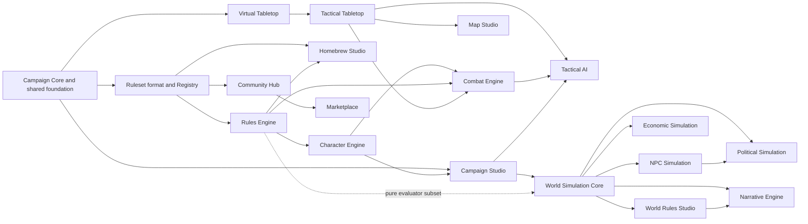
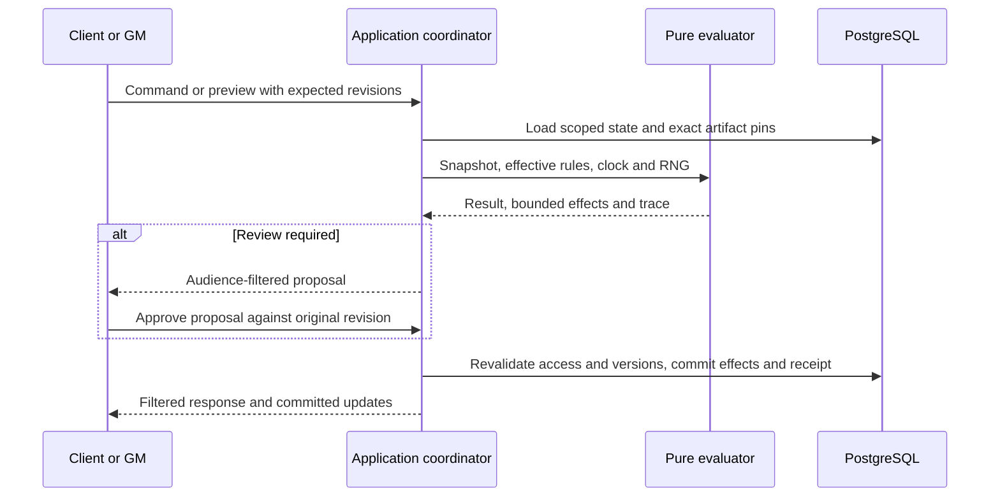

# Architecture

## CMD-ACL transaction boundary (V0.1.1, in progress)

The remaining command families use this ordering rule: session → campaign → membership rows → scene/folder/resource rows → dependent records, with sorted IDs for batches. Mutation and required audit share one PostgreSQL transaction; existing realtime publishers run after commit. Token duplicate locks all involved scenes in sorted ID order before token rows. Asset upload stages bounded files outside database locks, then rechecks access before its metadata/audit commit and file-renaming compensation. Protected original and thumbnail reads authorize before opening/reading bytes and use private no-store responses. The complete endpoint map and limitations are in [COMMAND_AUTHORIZATION_MATRIX.md](../security/COMMAND_AUTHORIZATION_MATRIX.md). Filesystem and PostgreSQL are not one atomic system; crash cleanup remains a documented operational limitation.

## V0.1 shape

The pnpm TypeScript workspace contains a React/Vite frontend, a Fastify application and shared Zod contracts. PostgreSQL owns durable state. Drizzle ORM and Drizzle Kit migrations manage the schema. Socket.IO carries realtime events. Uploaded media uses the local filesystem directory configured by `UPLOAD_DIR`.

```text
Browser (React, PixiJS)
  ├── HTTP JSON API ── Fastify ── route/domain logic ── Drizzle ── PostgreSQL
  └── Socket.IO ─────── auth + campaign room authorization ───────┘
                                      └── asset module ── local files
```

Shared Zod contracts validate command inputs and define public token, layer and object shapes. The browser sends commands and renders server results. The server owns roles, random results and committed state.

## Module boundaries

- `index.ts` starts and shuts down the HTTP process. `app.ts` configures the server, middleware and route registration. `config/runtime.ts` validates the deployment settings for this process.
- Route modules own auth, campaigns, invitations and membership, chat, initiative, scenes, scene content, tokens and assets. `security/access.ts` shares session, role and body validation. `domain/projections.ts` owns sensitive projection rules. `realtime/` owns session and campaign subscriptions, command limits and socket commands.
- `modules/tokens/movement.ts` handles single Socket.IO movement and REST group updates. `security/commandAccess.ts` provides row-locking queries for session and campaign authorization. `realtime/movementEvents.ts` delivers committed movement and group updates. Other feature transactions and publications remain in their route modules.
- `modules/objects/lifecycle.ts` handles group delete/restore, point deletion and permanent own-drawing cleanup. The layer and object writers share its access and lock ordering. `realtime/campaignAudience.ts` batches live audience authorization for object lifecycle, token movement, pointer delivery and scene notifications.
- The web app uses a scoped snapshot-and-event hook in `features/tabletop/useTabletopSync.ts`, versioned undo/redo in `useCommandHistory.ts`, an HTTP helper in `services/api.ts` and the lazy Pixi component in `ui/TableCanvas.tsx`. `App.tsx` retains page assembly and several workflow handlers.

## State flow and concurrency

HTTP and WebSocket operations resolve identity and campaign role. Scene, token, object and initiative writes use optimistic versions. Token groups, object copy and lifecycle groups use PostgreSQL transactions. The browser rejoins after reconnect and reloads its scoped snapshots. Some permission checks precede their mutation transaction. See [realtime details](REALTIME_PROTOCOL.md) for current limits.

### Token movement transaction

The service uses PostgreSQL `READ COMMITTED`. It locks the session, parses the shared Zod contract, resolves UUIDs and locks the active campaign record, the current membership and the scene. It locks live target tokens by ascending UUID. A single command requires a joined campaign. A group requires Owner/GM and 2–50 distinct targets. Managers can access non-archived drafts. Players must own a visible token on the active scene. Coordinates use the existing finite −10,000 to 10,000 range. A locked token rejects a positional edit, including an attempt to unlock and move it in one group patch. A property-only unlock remains available.

The order is session → campaign → memberships by user UUID → scene → tokens by token UUID. Session, campaign, membership and scene reads use `FOR SHARE`. Mutable token rows use `FOR NO KEY UPDATE`. PostgreSQL rechecks a row after waiting for a concurrent update or delete. Logout and rotation delete the same session row. Membership removal and role changes write the same membership row. Token locking and visibility edits use the same token row and version. Ownership reassignment locks both the acting member and the prospective owner in UUID order before the scene and token. Scene activation, archive and reordering take the campaign with `FOR NO KEY UPDATE` before touching scene rows. Token copies take campaign and membership locks before locking source tokens in UUID order. Disjoint token moves can proceed concurrently.

The service rechecks session expiry after waiting. It authorizes and version-checks the entire group before applying any update. The token updates use the expected version in the predicate, increment it once per token and commit with their audit rows. If withdrawal commits first, movement uses the new permissions. A movement holding the relevant locks can commit before withdrawal, and subsequent movement uses the new permissions. Explicit locks and version predicates cover these resources at the existing isolation level. The service has no Serializable retry loop.

The commit returns the caller's authorized projection and the affected token IDs and visibility transitions. The publisher locks current audience and token state in a follow-up transaction before queuing Socket.IO packets. Current roles and visibility govern delivery if they change after the write. Audit rows record committed actions. Delivery is best effort, with snapshots on reconnect. Command IDs and stored acknowledgements remain future work.

### Scene object lifecycle transaction

`PATCH /api/scenes/:sceneId/object-lifecycle` accepts 1–50 distinct objects with expected versions. Owner and GM can operate on writable layers in active and draft scenes. The service preserves each object's ID, author, geometry and visibility. It changes only the deletion timestamp and version. Players have no group restore or delete access. Their point deletion is permanent and limited to their own visible freehand strokes on a readable layer of the active scene. They can still clear their own drawings after drawing permission is turned off.

The order is session → campaign → membership → scene → layers by UUID → objects by UUID. The service uses PostgreSQL `READ COMMITTED`. It takes shared locks on session, campaign, membership, scene and relevant layers. It locks mutable objects with `FOR NO KEY UPDATE` or takes `FOR UPDATE` for permanent deletion. It verifies that each target is still on the layer identified before it waited. Object edits that move an object lock both source and target layers before the object. Layer edits take an exclusive write lock on the layer row. Layer removal locks the layer before deleting its tombstones. Scene archive takes the existing campaign lock first, and role changes and logout write the same membership and session rows that lifecycle reads.

The service validates the whole batch before a single set-based write scoped to the scene, object IDs, individual expected versions and deletion state. The audit insert is in the same transaction. The publisher runs after commit. It reauthorizes current recipients and locks the scene, affected layers and surviving objects before queuing packets. Superseded revisions are skipped. Player projections omit creator IDs, and a restore still needs both layer and object visibility before it can reach Players. Reconnect snapshots recover durable state.


### Private campaign channels

Chat and dice hold current session, campaign and ordered membership locks through append. At publication, personal or campaign rooms select candidates. The shared audience reader batches session and membership locks. Session expiry and local subscription are checked immediately before enqueue. Chat selects its actual participants. Dice selects current managers for hidden results. Successful ACKs use the same authorization.

Initiative takes a campaign `FOR NO KEY UPDATE` gate for mutations and shares that gate when reading tracker and entries. Scene archival/activation invalidates the prior tracker under the same write gate. Current linked token rows are locked in ID order to apply their current visibility. Token note writers take session, campaign, membership, scene and token locks in that order. Publication verifies the effective owner and token revision on the same gated audience read.

Migration `0019_initiative_scene_scope` fills the scene for an unambiguous legacy tracker on the active scene. Unscoped or inactive legacy scenes get a stopped, empty projection. Legacy entry rows remain until a normal start replaces them.

## Security and operations

Ordinary object create/copy/edit/move and layer create/edit/delete use transactional authorization in the same order as object lifecycle. The post-commit publisher reuses `withSceneAudience` for batched session, campaign, role and scene locks. Object and layer rules stay in the scene-content publisher. Exact-revision upserts, ID-only removals after a lost public projection, and role-filtered snapshot refresh suffice for the current client. The only publication retry is a second lock attempt if a formerly public object moved outside the discovered set of layers while the publisher acquired its locks.

The security review tracks projection and media ACLs by role. The closed-alpha Compose configuration has locally verified HTTPS and shutdown paths. Operators manage deployment secrets, network restrictions and backups. [Security review](../security/V0.1.1_REVIEW.md) · [Production deployment](../operations/PRODUCTION_DEPLOYMENT.md)

## Planned module boundaries

The future architecture stays within the modular monolith. Each module owns its state and writes. Application services pass validated commands and read-only snapshots through explicit interfaces. A coordinator can commit changes in one PostgreSQL transaction when an action crosses module boundaries. Modules and tests listed below are design targets.

| Module | Owns | Exposes to other modules |
| --- | --- | --- |
| Campaign Core and Campaign Studio | Identity, memberships, roles, selected configuration and session preparation. Studio adds notes, schedules, encounter templates and timeline | Campaign context, scoped lookups, GM policy and audience-filtered timeline |
| Virtual and Tactical Tabletop | Scenes, tokens and geometry, placement, movement, sight and lighting | Versioned spatial snapshot and server queries for movement, distance and perceived entities. [Tactical architecture](TACTICAL_TABLETOP_ARCHITECTURE.md) |
| Ruleset Registry, Rules Engine and Homebrew Studio | Immutable rule artifacts, package composition, bounded evaluation, draft authoring and publication | Exact package lock, resolved definitions, typed evaluation with trace. [Ruleset architecture](RULESET_ARCHITECTURE.md) · [Homebrew](HOMEBREW_ARCHITECTURE.md) |
| Character Engine | Game entity identity, sheets, inventories, resources and derived values | Versioned entity view, declarative effects and field-scoped projections. [Character Engine](CHARACTER_ENGINE.md) |
| Combat Engine and Tactical AI | Encounter action lifecycle and choice of autonomous game actions | Valid action choices, proposed effects, commits and receipts. [Combat Engine](COMBAT_ENGINE.md) · [Tactical AI](TACTICAL_AI.md) |
| World Core | Optional World Instance, clock, calendar, step execution, snapshots, approval and history | Bounded preview/apply commands and provenance-linked facts. [World Simulation](WORLD_SIMULATION.md) |
| NPC, Political and Economic Simulation | Each module's state, laws and proposals against a world snapshot | Typed, separately enabled world rules. [NPC](NPC_SIMULATION.md) · [Politics](POLITICAL_SIMULATION.md) · [Economy](ECONOMIC_SIMULATION.md) |
| World Rules Studio and Narrative Engine | Draft custom world laws and GM-reviewed story proposals | Validated law bundles and audience-scoped narrative events. [World Rules Studio](WORLD_RULES_STUDIO.md) · [Narrative Engine](NARRATIVE_ENGINE.md) |
| Map Studio | Editable map documents and explicit export variants | Versioned asset and geometry snapshots. A scene imports a selected revision through the V0.2 geometry interface |
| Community Hub and Marketplace | Discovery, consent, moderation, public metadata and entitlements | Permission-checked publication and catalog views for assets cleared for distribution. [Licensing strategy](../product/RULESET_LICENSING_STRATEGY.md) |

### Dependency map

Arrows point from prerequisite contract to consumer. The shared foundation is access, typed transport, versioned writes and projections. Optional runtime features can be disabled per campaign. Combat passes typed effects to character and spatial application services through the coordinator. This adds no dependency from Character or VTT back to Combat.



Character Studio needs only the first rules format and evaluator subset. The later Rules Engine release extends it. The full registry import flow and visual editors follow their own gates. World Rules Studio uses the World Core interface. Its release additionally needs representative NPC, political and economic laws for test coverage. World laws and character rules can reuse pure expression semantics with distinct operators, program types and policies.

### Shared contracts for future work

| Concept | Proposed contract and invariant |
| --- | --- |
| Identity and references | Stable opaque IDs for campaigns, scenes, tokens, entities, assets and world instances. Resolve references within campaign authorization. A token is a placement that may refer to an entity. A world NPC may optionally link to a character |
| Commands and concurrency | Server-resolved actor and request scope, input versions for mutable records, action schema and bounded changes. Commands with replayable side effects use a scoped command ID and an original result recorded with the commit. A retry with different input under the same ID fails. Commit checks current permissions and versions inside the write boundary |
| Packages and evaluation | Read-only inputs with exact versions, fixed execution semantics and a supplied clock or RNG where applicable. Return a typed result, affected references and trace. Pure evaluation has no I/O. The caller owns writes |
| Projections and confidentiality | Derive viewer, actor and audience access server-side. Filter response fields, asset references, events, histories, logs and export. Trace and derived results inherit the visibility of their inputs unless an authorized rule explicitly releases an allowed summary |
| Events and causality | Facts describe committed outcomes with a schema version, source revision and causal references when needed. Publish after commit via existing transport. Long replay, scheduling and durable delivery get their own requirements and implementation gates |
| Changes and recovery | Distinguish wire version, rule package version, evaluator/format version and record revision. Reconstruct prior interpretation from pinned artifacts. Conflict-aware reversal is a new command. Bulk simulation recovery has snapshot and history requirements |



### V0.1.1 guardrails

- Review and harden the current-session delivery of private chat, hidden dice and GM initiative next. Verify revocation and demotion at the publication boundary. Track lost acknowledgements for non-idempotent chat and dice separately.
- Preserve current IDs, stored campaigns, projections, optimistic versions and existing API payloads. V0.1.1 token coordinates and scene geometry use different current units. V0.2 owns the explicit conversion and geometry versioning, following its measured baseline.
- Treat the current dice expression, initiative tracker and bounded token resource fields as legacy tabletop capabilities. Future rule packages can opt into other models. Keep future snapshots free of assumptions about mandatory turn order, classes or hit points.
- Future package metadata, character and world schemas, evaluator and editors start with their named releases. The current refactor has enough work in authorization, projections, concurrency, reconnect, lifecycle and manual acceptance. [Release checkpoints](../product/LONG_TERM_IMPLEMENTATION_PLAN.md)

### Lost-response recovery

Chat and dice use operation-specific UUIDs and payload digests stored on their persisted rows, protected by scoped PostgreSQL unique indexes. A transaction rollback leaves no reservation; a committed replay returns the original allowed result after current authorization. Dice contenders serialize before generating a persisted random result. Replays do not create a second row or enqueue another realtime event. This is not network exactly-once delivery and is not a generic command framework. Creates, copies, uploads, and other state-changing requests still require explicit reconciliation or a later operation-specific recovery mechanism. [Policy and operation inventory](COMMAND_RETRY_POLICY.md)
