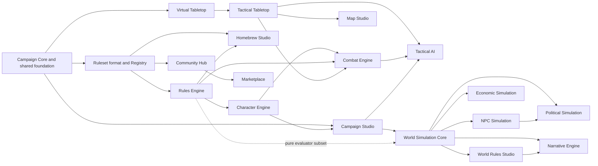
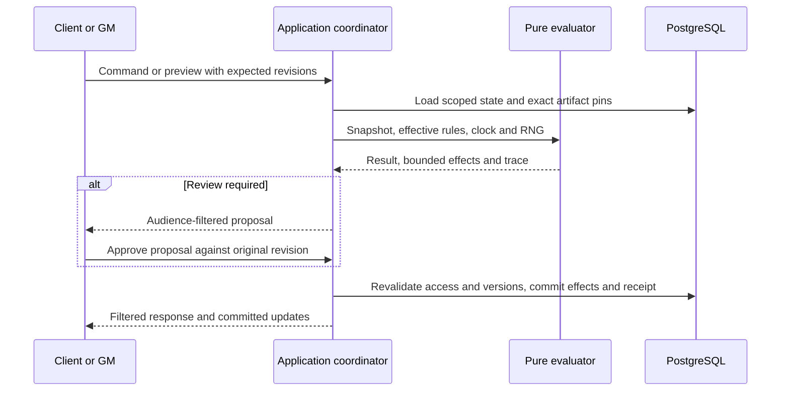

# Architecture

## V0.1 shape

The pnpm TypeScript workspace contains a React/Vite frontend, a Fastify application and shared Zod contracts. PostgreSQL owns durable state. Drizzle ORM and Drizzle Kit migrations manage the schema. Socket.IO carries realtime events. Uploaded media uses the local filesystem directory configured by `UPLOAD_DIR`.

```text
Browser (React, PixiJS)
  ├── HTTP JSON API ── Fastify ── route/domain logic ── Drizzle ── PostgreSQL
  └── Socket.IO ─────── auth + campaign room authorization ───────┘
                                      └── asset module ── local files
```

Shared Zod contracts validate command inputs and define public token, layer and object shapes. The browser sends commands and renders server results. The server owns roles, random results and committed state.

## Module boundaries

- `index.ts` starts and shuts down the HTTP process. `app.ts` configures the server, middleware and route registration. `config/runtime.ts` validates the deployment settings for this process.
- Route modules own auth, campaigns, invitations and membership, chat, initiative, scenes, scene content, tokens and assets. `security/access.ts` shares session, role and body validation. `domain/projections.ts` owns sensitive projection rules. `realtime/` owns session and campaign subscriptions, command limits and socket commands.
- Several transactions and publications still sit in the feature route modules. Extracting shared token and scene mutation services remains open.
- The web app uses a scoped snapshot-and-event hook in `features/tabletop/useTabletopSync.ts`, versioned undo/redo in `useCommandHistory.ts`, an HTTP helper in `services/api.ts` and the lazy Pixi component in `ui/TableCanvas.tsx`. `App.tsx` retains page assembly and several workflow handlers.

## State flow and concurrency

HTTP and WebSocket operations resolve identity and campaign role. Scene, token, object and initiative writes use optimistic versions. Token groups, object copy and lifecycle groups use PostgreSQL transactions. The browser rejoins after reconnect and reloads its scoped snapshots. Some permission checks precede their mutation transaction. See [realtime details](REALTIME_PROTOCOL.md) for current limits.

## Security and operations

The security review tracks projection and media ACLs by role. The closed-alpha Compose configuration has locally verified HTTPS and shutdown paths. Operators manage deployment secrets, network restrictions and backups. [Security review](../security/V0.1.1_REVIEW.md) · [Production deployment](../operations/PRODUCTION_DEPLOYMENT.md)

## Planned module boundaries

The future architecture stays within the modular monolith. Each module owns its state and writes. Application services pass validated commands and read-only snapshots through explicit interfaces. A coordinator can commit changes in one PostgreSQL transaction when an action crosses module boundaries. Modules and tests listed below are design targets.

| Module | Owns | Exposes to other modules |
| --- | --- | --- |
| Campaign Core and Campaign Studio | Identity, memberships, roles, selected configuration and session preparation. Studio adds notes, schedules, encounter templates and timeline | Campaign context, scoped lookups, GM policy and audience-filtered timeline |
| Virtual and Tactical Tabletop | Scenes, tokens and geometry, placement, movement, sight and lighting | Versioned spatial snapshot and server queries for movement, distance and perceived entities. [Tactical architecture](TACTICAL_TABLETOP_ARCHITECTURE.md) |
| Ruleset Registry, Rules Engine and Homebrew Studio | Immutable rule artifacts, package composition, bounded evaluation, draft authoring and publication | Exact package lock, resolved definitions, typed evaluation with trace. [Ruleset architecture](RULESET_ARCHITECTURE.md) · [Homebrew](HOMEBREW_ARCHITECTURE.md) |
| Character Engine | Game entity identity, sheets, inventories, resources and derived values | Versioned entity view, declarative effects and field-scoped projections. [Character Engine](CHARACTER_ENGINE.md) |
| Combat Engine and Tactical AI | Encounter action lifecycle and choice of autonomous game actions | Valid action choices, proposed effects, commits and receipts. [Combat Engine](COMBAT_ENGINE.md) · [Tactical AI](TACTICAL_AI.md) |
| World Core | Optional World Instance, clock, calendar, step execution, snapshots, approval and history | Bounded preview/apply commands and provenance-linked facts. [World Simulation](WORLD_SIMULATION.md) |
| NPC, Political and Economic Simulation | Each module's state, laws and proposals against a world snapshot | Typed, separately enabled world rules. [NPC](NPC_SIMULATION.md) · [Politics](POLITICAL_SIMULATION.md) · [Economy](ECONOMIC_SIMULATION.md) |
| World Rules Studio and Narrative Engine | Draft custom world laws and GM-reviewed story proposals | Validated law bundles and audience-scoped narrative events. [World Rules Studio](WORLD_RULES_STUDIO.md) · [Narrative Engine](NARRATIVE_ENGINE.md) |
| Map Studio | Editable map documents and explicit export variants | Versioned asset and geometry snapshots. A scene imports a selected revision through the V0.2 geometry interface |
| Community Hub and Marketplace | Discovery, consent, moderation, public metadata and entitlements | Permission-checked publication and catalog views for assets cleared for distribution. [Licensing strategy](../product/RULESET_LICENSING_STRATEGY.md) |

### Dependency map

Arrows point from prerequisite contract to consumer. The shared foundation is access, typed transport, versioned writes and projections. Optional runtime features can be disabled per campaign. Combat passes typed effects to character and spatial application services through the coordinator. This adds no dependency from Character or VTT back to Combat.



Character Studio needs only the first rules format and evaluator subset. The later Rules Engine release extends it. The full registry import flow and visual editors follow their own gates. World Rules Studio uses the World Core interface. Its release additionally needs representative NPC, political and economic laws for test coverage. World laws and character rules can reuse pure expression semantics with distinct operators, program types and policies.

### Shared contracts for future work

| Concept | Proposed contract and invariant |
| --- | --- |
| Identity and references | Stable opaque IDs for campaigns, scenes, tokens, entities, assets and world instances. Resolve references within campaign authorization. A token is a placement that may refer to an entity. A world NPC may optionally link to a character |
| Commands and concurrency | Server-resolved actor and request scope, input versions for mutable records, action schema and bounded changes. Commands with replayable side effects use a scoped command ID and an original result recorded with the commit. A retry with different input under the same ID fails. Commit checks current permissions and versions inside the write boundary |
| Packages and evaluation | Read-only inputs with exact versions, fixed execution semantics and a supplied clock or RNG where applicable. Return a typed result, affected references and trace. Pure evaluation has no I/O. The caller owns writes |
| Projections and confidentiality | Derive viewer, actor and audience access server-side. Filter response fields, asset references, events, histories, logs and export. Trace and derived results inherit the visibility of their inputs unless an authorized rule explicitly releases an allowed summary |
| Events and causality | Facts describe committed outcomes with a schema version, source revision and causal references when needed. Publish after commit via existing transport. Long replay, scheduling and durable delivery get their own requirements and implementation gates |
| Changes and recovery | Distinguish wire version, rule package version, evaluator/format version and record revision. Reconstruct prior interpretation from pinned artifacts. Conflict-aware reversal is a new command. Bulk simulation recovery has snapshot and history requirements |



### V0.1.1 guardrails

- Continue stabilizing the existing REST and Socket.IO paths. Prioritize the shared token-movement transaction, current permissions at commit and regression tests for in-flight role changes. Keep the existing lost-acknowledgement follow-up focused on concrete non-idempotent command paths.
- Preserve current IDs, stored campaigns, projections, optimistic versions and existing API payloads. V0.1.1 token coordinates and scene geometry use different current units. V0.2 owns the explicit conversion and geometry versioning, following its measured baseline.
- Treat the current dice expression, initiative tracker and bounded token resource fields as legacy tabletop capabilities. Future rule packages can opt into other models. Keep future snapshots free of assumptions about mandatory turn order, classes or hit points.
- Future package metadata, character and world schemas, evaluator and editors start with their named releases. The current refactor has enough work in authorization, projections, concurrency, reconnect, lifecycle and manual acceptance. [Release checkpoints](../product/LONG_TERM_IMPLEMENTATION_PLAN.md)
