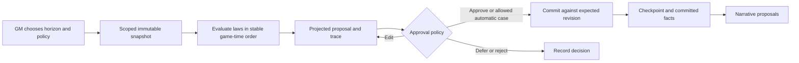

# World Simulation Engine

[Adventure Builder](../design/ADVENTURE_BUILDER.md) distinguishes reusable world definitions from each campaign's state and records the GM's control over time and delayed consequences.

**Status · PLANNED from V0.6.** The optional World Instance belongs to a campaign. It owns a monotonic world revision, custom calendar, logical game-time coordinate, enabled systems, exact law/evaluator versions, pending consequences and a checkpoint history. Campaign entities link to the world by stable scoped references.

## World model

Territories, regions, settlements, populations, institutions, factions, relationships, resources, production, trade, culture, religion, laws, political relationships, conflicts, NPCs and events are optional typed extensions. A world can have aggregate populations, individual actors, or both. Domain choices and simulation depth are selected by its GM. Fictional institutions, currencies, genres and era-specific assumptions live in laws and definitions.

Game time uses integer ticks and a versioned calendar conversion. Calendar display, holidays, month lengths and local time labels are configuration over the tick coordinate. Simulation runs on explicit campaign commands. A later scheduler requires opt-in real-time mapping, pause and restart policy, and the same approval path as a manual step. A job firing alone grants no permission to apply events.

## Step contract and control

`PreviewStep(worldId, expectedRevision, horizon, policyRevision) → Proposal`. The proposal identifies the exact starting snapshot, end tick, law lock, evaluator version, RNG algorithm and state, typed effects, future events, causal facts, execution counters and approval requirements. Changing a proposal requests a validated edit or a new preview. The original published cause remains inspectable to authorized users.

The evaluator processes due events in stable order by tick, declared phase, priority and stable event/rule ID. At each phase laws read the defined snapshot and propose effects. The owning module reconciles compatible changes with an explicit reducer or a deterministic allocation policy. Incompatible effects produce a reviewable conflict. Later phases use the committed-in-proposal results of preceding phases. The interpreter cannot fetch state or write to other modules.

Run previews with per-step and per-root budgets for entities, draws, rule evaluation, effects and event depth. Same-tick events need an explicit later phase and deduplication key. Snapshot tables and typed change records are sufficient for initial replay and provenance. Long previews can be chunked or moved to a bounded in-process worker after profiling. Each chunk verifies the original inputs, and partial previews remain unavailable for application.

## Persistence and recovery

GM controls manual stepping, between-session batches, pause, preview, allowed routine auto-apply and critical-event approval. The default is preview and approval. Changed laws, policy, input revisions or permission during review invalidate commit. Duplicate application returns the existing receipt for authorized callers. Record canonical input and result hashes, seeds or draw state, evaluator version and causal ancestry. Backups include any artifacts required for replay.

Keep snapshots at selected revision boundaries and record typed changes between them. A restore or rollback is a new authorized operation. Preview the affected state and downstream consequences first. Validate linked writes and published outcomes before committing an isolated restore or a compensating transition. Avoid automatic rewinds across accepted encounters, released story events or shared future state.

Release tests compare independent runs from the same inputs, exercise omitted systems and custom calendars, recover after interruption, reject conflicting previews, enforce pause/policies and keep private state out of proposed player events. [World Rules Studio](WORLD_RULES_STUDIO.md) · [Narrative Engine](NARRATIVE_ENGINE.md)
