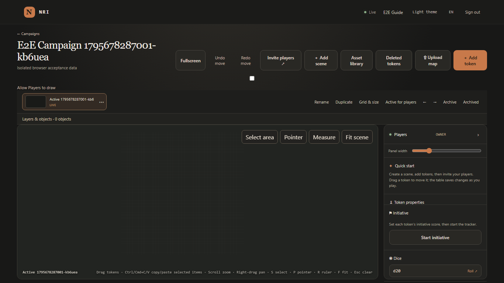
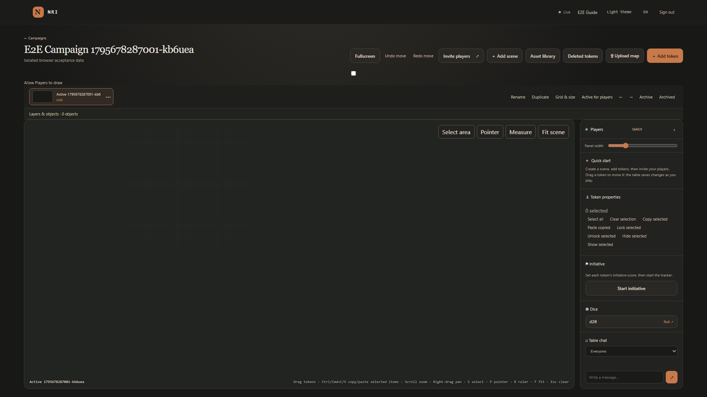
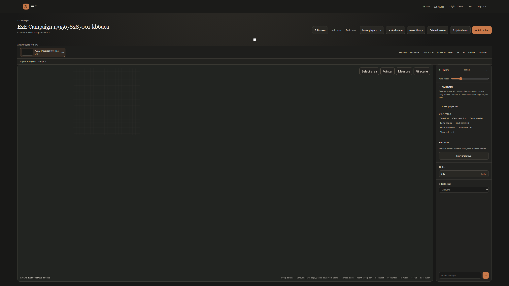

# V0.1.1 acceptance report

- **Report date:** 2026-11-27
- **Release:** Tabletop Foundation Completion & Playability
- **Status:** `IN_PROGRESS`
- **Branch:** `codex/v0-1-foundation-vtt`
- **Baseline:** `d919e7624e28a1b0e51009b9a2dfa8439776a1b7`
- **Pull request:** [#1](https://github.com/Jerry93Sky/NRI/pull/1), draft/open; not merged.

This report records the V0.1.1 implementation and verification evidence to date. It is not an acceptance declaration. The branch now includes scene preparation and active-scene privacy, editable scene objects, token properties/resources/notes and recovery, campaign asset folders, a playable demo campaign and copy flow, tabletop tools, and no-overwrite backup/restore utilities. Several product and technical gates remain open; see the status and open-items sections below.

## Foundation stabilization checkpoint — 2026-11-27

The current status is `IN_PROGRESS`. The [baseline and finding registry](../audits/FOUNDATION_AUDIT.md) identify the starting branch SHA and original checks. The [remediation log](../audits/FOUNDATION_REMEDIATION.md) tracks the follow-up scope.

| Area | Latest evidence |
| --- | --- |
| Local quality | Frozen install, build and typecheck passed. Vitest passed 34 tests. Isolated PostgreSQL reached 19 migrations. Multiplayer smoke, all 9 Chromium scenarios and a dedicated preview build renderer test passed |
| Browser evidence | Playwright captured GM and Player at 1366×768, 1920×1080 and 2560×1440 and checked horizontal overflow and usable canvas dimensions |
| Backend and web architecture | Fastify module composition, centralized session and visibility projections, scoped workspace snapshots, shared layer/object contracts and bounded command history |
| Multiplayer and security | PostgreSQL smoke verified active session revocation, independent sessions, role demotion across connections, archived room eviction, former-owner note isolation, concurrent token revisions and recent private/public history |
| History | Browser coverage exercised group object creation undo/redo, preservation of IDs, and an atomic conflict after another GM saves a newer edit. Token movement and editable token/object fields use the same version-aware browser history. Bulk Player freehand erasure is permanent |
| Migration and runtime | Additive scene object recovery migration, separate alpha Compose, HTTPS, validated cookies, WebSocket and clean shutdown. [Alpha procedure](../operations/PRODUCTION_DEPLOYMENT.md) |
| Backup | Captured the quiesced generated Amber fixture. Restore verifier matched 12 table counts and 12 original asset SHA-256 checksums. Repeated after migration. [Log](../operations/BACKUP_RESTORE.md) |
| Performance | Repeatable profiles A/B/C on local SwiftShader recorded frame timing, RTT, client delivery, load, switches, process memory/CPU, SQL counts and traffic. The larger profiles remain slow. [Results and limits](../performance/LOAD_TEST_REPORT.md) |
| Owner and next release | [Manual acceptance](V0.1.1_MANUAL_ACCEPTANCE.md), [V0.2 scope](V0.2_SCOPE.md) and [PR sequence](V0.2_IMPLEMENTATION_PLAN.md) |

Open technical items include transactional authorization for other command paths, retry/deduplication for non-idempotent writes, broader security coverage, renderer benchmarking on hardware, further UI and application-service extraction, and editing gestures beyond the automated matrix. The owner still needs to run a human GM/Player session.

The sections below preserve the previous increment and its verification history. See the checkpoint above and the [current PR checks](https://github.com/Jerry93Sky/NRI/pull/1/checks) for the current state.

## Transactional token movement — 2026-11-27

Single Socket.IO movement and REST group updates share one application service. PostgreSQL locks current session, campaign, membership, scene and token rows in that order. The transaction validates targets and versions, applies token changes and writes audit rows. A rejected group changes no rows. The realtime publisher starts after commit and checks current recipient permissions and visibility. See the [movement transaction](../architecture/ARCHITECTURE.md#token-movement-transaction) and [security evidence](../security/V0.1.1_REVIEW.md#token-movement-audit--2026-11-27).

The 23-scenario PostgreSQL regression check covers both orders of membership withdrawal and movement, role demotion, owner reassignment, scene archive, token lock, logout, overlapping groups, out-of-scope requests, conflict projection, reconnect and rollback. Race ordering uses the PostgreSQL lock graph. Tests also check persisted coordinates and versions, audit records and Socket.IO packets. To reproduce, set `NODE_ENV=test`, point `DATABASE_URL` at an empty local `nri_test` or `nri_command_test` database, set `SESSION_SECRET`, apply migrations and start the API in test mode. Set `NRI_API_URL` to that API and run `corepack pnpm@12.23.0 --filter @nri/server test:movement`. The script creates disposable fixtures in that database.

Local verification covered build, typecheck, 34 Vitest tests, 19 migrations on a fresh PostgreSQL 16.15 test database, multiplayer smoke, all nine Chromium scenarios, one extra Pixi preview smoke, Compose configuration and the dependency audit. No schema change was required for this increment.

[CI run 45920211905](https://github.com/Jerry93Sky/NRI/actions/runs/45920211905) failed during Playwright Chromium dependency installation. The Ubuntu 26.04 runner received HTTP 403 for the Microsoft APT repository. CI now pins the Playwright-supported Ubuntu 24.04 runner and retains the Chromium installation, preview renderer smoke, full browser suite and PostgreSQL checks. The status for the exact PR head is available in [PR checks](https://github.com/Jerry93Sky/NRI/pull/1/checks).

The following checkpoint records the extracted scene-object lifecycle service. The V0.1.1 acceptance criteria and manual owner review remain in place.

## Transactional scene object lifecycle

Baseline `4fd8fb16b5d054d8a2c9064fd1a5e74f6fe4bd8c` passed [CI #191](https://github.com/Jerry93Sky/NRI/actions/runs/45922487423). The group REST request and response retain their existing shape. Owner/GM delete and restore preserve the prior object ID and increment its version. The Player point-delete and own-drawing clear remain permanent operations. PostgreSQL locks authorization, scene, layers and objects in that order. No new migration was required. A fresh PostgreSQL 16.15 database applied all 19 existing migrations, including `0018_scene_object_recovery`.

The isolated suite passed 28 scenarios. It uses actual REST writers and the PostgreSQL lock graph to order role changes, session logout, member withdrawal, layer locking and removal, object edit and move, scene archive and overlapping batches. It checks SQL state, versions, audit rows and Socket.IO packets. The Chromium history scenario exercises group undo/redo, identity and version preservation, stale conflict without advancing history, point delete/undo/redo and history isolation across scene and campaign changes. [Security evidence](../security/V0.1.1_REVIEW.md#object-lifecycle-audit--2026-11-27)

Run `corepack pnpm@12.23.0 --filter @nri/server test:object-lifecycle` against a loopback API in test mode and migrated local `nri_test` or `nri_object_test` database. The suite writes disposable fixtures. The same test runs in CI alongside the 23 token movement cases. See [checks for the current PR head](https://github.com/Jerry93Sky/NRI/pull/1/checks).

Local checks also passed frozen installation, build, typecheck, 34 unit tests, all 23 token movement regressions, multiplayer smoke, the Pixi preview smoke, all 9 Chromium scenarios, dependency audit, Compose validation, tracked-secret scanning and `git diff --check`.

### SQL and delivery measurement

Local Windows API, Docker PostgreSQL 16.15, loopback HTTP and WebSockets, and 12 alternating delete/restore requests per configuration. The profile counted `pg_stat_statements` calls for the group endpoint and used the client clock from request dispatch to HTTP response and last packet. No request overlay or artificial delay was applied.

| Objects | Connected recipients | SQL statements per request | BEGIN/COMMIT statements | Median HTTP, ms | Median last packet since request, ms | Median last packet after HTTP response, ms |
| --- | ---: | ---: | ---: | ---: | ---: | ---: |
| 1 | 0 | 11 | 2 | 17.28 | — | — |
| 10 | 0 | 11 | 2 | 16.86 | — | — |
| 1 | 1 | 17 | 4 | 14.85 | 20.46 | 5.51 |
| 10 | 1 | 17 | 4 | 16.12 | 21.93 | 5.75 |
| 1 | 4 | 17 | 4 | 14.82 | 20.63 | 5.86 |
| 10 | 4 | 17 | 4 | 18.61 | 25.75 | 7.78 |

Delivery adds six batched queries per operation with a nonempty audience. No per-object or per-recipient SQL appears in these paths. Packet formation and sending still scale with the number of visible object–socket pairs. The last column is measured client receipt relative to the HTTP response. It includes local transport and scheduling. Large crowds, cold caches and lock contention were outside this profile. To reproduce, enable `pg_stat_statements` with utility tracking in a dedicated `nri_object_test` instance, create its extension and run the suite with `NRI_OBJECT_PERF=1`.

## Secure realtime scene content

The baseline `7fd3d6bebe44383b55a1e0038a79ef9d94cf0d7c` passed [CI #192](https://github.com/Jerry93Sky/NRI/actions/runs/45925004633). The event audit inventories 24 application event names. Create, copy and edit/move of objects and create, edit and deletion of layers use current audience checks after audited commits. Clients reopen layers through current snapshots, remove hidden items on ID-only events and use event payloads as invalidations. [Event matrix](../security/REALTIME_EVENT_MATRIX.md)

Run `corepack pnpm@12.23.0 --filter @nri/server test:realtime` against a migrated loopback `nri_test` or `nri_realtime_test` and test API. The 20 PostgreSQL scenarios gate real requests with the lock graph, assert DB state and deliveries, and cover recipient role, membership, expiry, logout, archive, visibility, overlapping revisions and rollback. The browser scenario replays captured object packets after newer revisions, layer hide, deletion and campaign switch. [Current CI](https://github.com/Jerry93Sky/NRI/pull/1/checks)

The separate loopback profile measured 1, 10 and 50 objects and up to eight eligible sockets. SQL remained batched across both dimensions. The prior lifecycle profile is retained above. [P50/P95, bytes and projection measurements](../performance/SCENE_REALTIME_PROFILE.md)

Local verification covered frozen installation, build, typecheck, 34 unit tests, all 19 migrations, multiplayer smoke, 23 token movement cases, 28 lifecycle cases, 20 scene-content delivery cases, the built Pixi smoke, all nine Chromium cases, dependency audit, Compose validation, tracked-secret scanning and `git diff --check`.

Broader private event delivery, representative payload and hardware performance, and owner-run acceptance remain open under the existing V0.1.1 gates. Next verify and harden private chat, hidden dice and manager initiative delivery under concurrent role or session revocation.

## Private channel security and closure audit

Baseline `1fedb6f3af7585c27d599ceaefd682d9641661ee`, CI #193. Chat, dice, initiative and token notes now use current PostgreSQL authorization at enqueue. The check also applies to chat/dice acknowledgements. The Player initiative projection omits the hidden entry and current-turn ID. The client reloads scoped initiative state, discards late privileged responses and clears a note on ownership loss. The participant-only history rule is unchanged. [Security review](../security/V0.1.1_REVIEW.md#private-channel-audit) · [Remaining release gates](V0.1.1_CLOSURE_PLAN.md)

Run `corepack pnpm@12.23.0 --filter @nri/server test:private-channels` against a migrated loopback test API and a dedicated `nri_test` or `nri_private_test` PostgreSQL database. The 15 scenarios create disposable fixtures, order operations with `pg_blocking_pids`, check stored state independently, and assert both expected delivery and absent private network packets. Chromium uses three independent contexts and genuine captured frames. It covers duplicate private chat, hidden dice, live demotion with a held GM REST response, owner-note reassignment and replay, alongside reconnect and the existing campaign-switch history regression.

All 20 migrations applied on empty PostgreSQL 16.15. An isolated upgrade from the baseline's 19 migrations retained all five test entries. The unambiguously linked active tracker retained its version and round. Trackers with archived, mixed or unlinked scenes stopped, cleared their scene, and incremented their version. No deployment database was used. [Current CI for Draft PR #1](https://github.com/Jerry93Sky/NRI/pull/1/checks)

### Private delivery profile

Paired Windows Node 24.13.0 and Docker PostgreSQL 16.15 on loopback. Each build handled 20 sequential commands per event and socket count with `pg_stat_statements`. The clock measures command dispatch to ACK and to receipt at the last authorized socket. Bytes count serialized Socket.IO event arrays across the audience without framing or ACK bytes. Times are P50/P95 in ms.

| Event | Sockets | SQL baseline → current | ACK baseline → current | Last packet baseline → current | Current ACK to last packet | JSON bytes baseline → current |
| --- | ---: | ---: | ---: | ---: | ---: | ---: |
| Private chat | 1 | 3 → 8 | 8.71/13.75 → 15.68/36.25 | 8.78/13.84 → 15.80/36.42 | 0.09/0.22 | 285 → 338 |
| Private chat | 4 | 3 → 8 | 7.84/13.73 → 13.27/15.22 | 8.12/13.90 → 13.57/15.54 | 0.29/0.41 | 1,140 → 1,352 |
| Private chat | 8 | 3 → 8 | 7.35/11.15 → 12.96/15.90 | 7.77/12.23 → 13.40/16.29 | 0.39/0.63 | 2,280 → 2,704 |
| Hidden dice | 1 | 2 → 8 | 7.04/14.15 → 12.65/15.02 | 7.09/14.21 → 12.70/15.07 | 0.06/0.11 | 272 → 272 |
| Hidden dice | 4 | 2 → 8 | 6.12/7.03 → 13.91/36.15 | 6.28/7.19 → 14.12/36.28 | 0.18/0.38 | 1,088 → 1,088 |
| Hidden dice | 8 | 2 → 8 | 5.61/6.61 → 12.80/14.78 | 5.77/6.79 → 13.09/15.06 | 0.31/0.50 | 2,176 → 2,176 |

SQL counts exclude four new transaction boundary statements per command. The increase is fixed across the tested socket counts. Chat adds 53 bytes per recipient for the ID used in client participant filtering. At eight sockets last-packet P95 rose by 4.07 ms for chat and 8.27 ms for dice. A separate co-running browser/build sample produced substantially higher latency; it was excluded from the paired comparison and shows why these results are not a production latency bound. Lock hold time was not measured. To reproduce, enable `pg_stat_statements` in the dedicated test database and append `--profile` to the private-channel command. At four and eight sockets the chat profile uses sender and recipient sessions. The dice profile uses manager tabs of the same account.

### Windows restart readiness

The API's signal handlers call Fastify close. The pre-close hook disables readiness and closes Engine.IO. The close hook ends the PostgreSQL pool. Readiness requires a live query against the campaign table and a writable upload directory. Playwright takes the API PID from the isolated harness, stops it, observes the browser connection drop, starts a new Node child and watches both that child's exit and the readiness endpoint on the same port. Windows termination by `process.kill` does not establish that the POSIX graceful path ran. A ready response alone also does not prove which PID owns the listener.

The full Windows suite passed with a 59.2-second restart test. A focused Windows rerun reproduced the earlier readiness timeout with repeated `ECONNREFUSED` and no startup output from the child. Three direct probes using the same Node child command reached readiness in 2.82–4.08 seconds. Each listener PID matched the spawned child, the listener disappeared after termination, and a probe observed refusal within 5–14 ms. This evidence has not identified the cause of the intermittent Playwright startup stall. Timeouts and production shutdown behavior are unchanged. The recovery gate retains target-host process and shutdown evidence. [Closure plan](V0.1.1_CLOSURE_PLAN.md)

## Implemented in the previous increment

- Added a migration for scene order, active/published state, dimensions, grid appearance/offset/snap/distance settings, and camera center/zoom. Existing scenes receive a deterministic order and one active/published scene per campaign. The current local `nri_dev` and isolated `nri_e2e` journals reach `0016_married_otto_octavius`; isolated `nri_test` remains at `0014_milky_kronos`.
- Added scene rename and settings updates with optimistic versions; duplicate creates an unpublished draft and copies tokens with independent IDs while reusing the existing map asset reference.
- Added archive, restore, reorder, and GM activation flows. Archiving the active scene selects the most recently ordered remaining published scene as fallback when one exists.
- Added token property migrations and GM-only optimistic updates for appearance/visibility plus separate GM and token-owner notes. GM notes stay GM-only; owner notes are returned only to GMs and the assigned owner and update through a user-scoped socket event. Added two generic resource tracks with editable label/current/maximum/player visibility and bounded owner/GM +/- adjustments. Hidden resource tracks are omitted from player snapshots and realtime projections; players can adjust only a visible track on their own token. Token rendering shows visible labels and values. Player projections omit hidden token state, locked tokens reject movement, and hide/show socket transitions remove or recreate the public token without private metadata.
- Added scene-layer and scene-object tables with checks/indexes and four canonical layers per scene; clients can add custom layers, while canonical layer types are not client-creatable. Layer/object reads and mutations use campaign/scene authorization, optimistic versions, and campaign-scoped asset checks. Scene duplication copies layers and objects with independent IDs. A restrictive layer-object foreign key prevents deleting a layer from cascading into object loss. Player snapshots omit GM/non-visible layers and hidden objects; hidden transitions emit player-safe removals. The tabletop has a basic layer panel, active-layer selection and ordering, layer visibility/lock controls, line/rectangle/ellipse/text creation, GM freehand preview and persisted strokes, drawing color and stroke-width controls, active-layer canvas dragging and resize handles, object visibility/lock/color/delete, 15° rotation, opacity, z-order, same-scene layer move and duplicate controls, and shape rendering. GMs can add campaign-library images to an editable scene layer; Pixi loads and renders those image objects using the existing campaign-scoped asset endpoint. Text objects support localized prompt-based creation, canvas rendering, and prompt-based editing. Image/text object flows have not been manually exercised in the browser. Complete shape formatting, GM drag/resize, and broader drawing edit gestures have not been manually exercised in the browser; the permission-controlled Player stroke flow has automated browser coverage.
- Added local tabletop workspace controls: Players and GMs can resize or collapse the right rail, with these preferences saved in local browser storage, enter/exit fullscreen, and switch between locally persisted light/dark themes. The Chromium scenario verifies range adjustment, persistence, collapse/expand, fullscreen enter/exit, and theme preference storage. Tabbed panel organization and cross-device preference sync remain open.
- Added GM/Owner-controlled Player freehand drawing for active scenes, defaulting off. The server accepts only strokes on a visible, unlocked Objects layer, stores author IDs privately, and limits Players to versioned edits/deletes of their own strokes. Player snapshots expose only an `ownedByMe` boolean for the requesting user. Migration `0015_unknown_edwin_jarvis` was applied to isolated `nri_e2e`. API smoke verifies default denial, shape and GM-layer denial, ownership, restricted edits, deletion, creator-ID privacy, bulk clear, and revocation; Chromium coverage verifies the GM toggle, real Player canvas stroke creation, own-stroke deletion, own-stroke bulk clearing after permission revocation, and permission denial.
- Added a GM-only campaign asset library with button and drag-and-drop multi-file upload (up to 12 files per request, 12 MiB per file), category metadata, rename/category editing, search, name/size sorting, previews, total storage bytes, and usage counts for scene backgrounds, scene objects, and token images. Bounded 320×240 WebP thumbnails are generated for previews; the thumbnail endpoint applies the same campaign role and visible-use checks as the original asset. Unused-only deletion locks the asset row, checks references inside a transaction, then removes the original and derived thumbnail. File format is selected from PNG/JPEG/WebP signatures rather than client MIME. Header dimensions are bounded to 8192 pixels per axis and 64 Mi decoded pixels; Sharp performs bounded full decoding and malformed compressed pixel streams are rejected. Animated WebP and unsupported signatures are rejected. Older assets without a derived thumbnail generate one on the first authorized preview request. Migration `0012_past_xavin` stores asset name/category; `0013_absent_captain_marvel` adds token image references and restricts deletion of map/object assets. Migration `0017_complete_martin_li` adds campaign-scoped asset folders and nullable asset folder references. Folder create/rename/delete, assignment, filtering, Player denial, cross-campaign assignment denial, root fallback on folder deletion, and campaign-copy ID remapping are covered by isolated smoke and focused Chromium scenarios.
- Added campaign-scoped token image assignment through the token panel and drag-and-drop from TOKEN library cards onto the tabletop. Drops are translated through the current camera transform, bounded to the scene, optionally snapped, and persisted through the existing server-validated token endpoint. Pixi renders a rounded image with color fallback; a player may fetch its bytes only when an active-scene visible token references it. GM-only, draft, hidden, and unreferenced token images remain unavailable to players.
- Drafted a maintenance backup/restore procedure with no-overwrite rules, PostgreSQL custom dumps, media checksums, and isolated-restore steps. Restored the disposable `nri_test` database into a new target, matched 11 table counts, verified the SHA-256 manifest for 54 files, and matched all 10 database-referenced asset checksums. This local drill does not validate production backup scheduling or a fully quiesced maintenance window.
- Added recoverable token deletion with a GM/Owner-only campaign trash list, soft-delete timestamps, restore operations, optimistic-version checks, and snapshot/socket removal. Deleted tokens are excluded from player/GM scene snapshots but retain asset references until restored or a later retention policy is defined.
- Added bounded group token edits in batches of 2–50 for position, lock, visibility, name display, color, opacity, and z-order. The server locks rows, checks all expected versions before changing any token, applies the full batch in one transaction, and returns a conflict without partial changes when any version is stale. The GM selects tokens in the property rail and dragging one selected, editable token moves the selected editable group together. A 20-step movement-only undo/redo history submits the inverse move with the versions returned by the server, so stale actions conflict instead of overwriting newer edits. Single- and multi-token copy/paste use Ctrl/Cmd+C/V and server transactions, create new IDs, and clear token owner and owner note. A stale item rejects the complete group copy without partial tokens; history for other edit types remains open.
- Added scene-object group selection in the layer list with Shift/Ctrl/Cmd-click, capped at 50 objects. Ctrl/Cmd+C/V copies the selection to the active editable layer through a version-checked server transaction. Every source version is checked before inserts; clones receive independent IDs, preserve source visibility (GM-layer copies remain hidden), and conflicts leave the scene unchanged. Contract and two-context Playwright coverage include duplicate IDs, selection limits, successful group paste, stale-source no-partial behavior, Player projection, and Player write denial.
- Player scene lists and token snapshots are limited to the active, non-archived scene. Players cannot request tokens from drafts or archived scenes. Scene activation is broadcast as `{sceneId}`; active-scene setting changes broadcast a public projection. Member removal emits a user-scoped `membership:removed` notice before the socket is removed from campaign rooms.
- Added UI controls for scene lifecycle, confirmation dialogs, archive recovery, thumbnails, and grid/map/camera configuration. The color picker keeps unsaved changes out of the current scene state.
- Bounded grid drawing to scene dimensions. Camera zoom math preserves the world coordinate under the pointer and is covered by tests. Added map-based grid calibration: two canvas points define a measured world-space distance, the GM enters cell count, and cell size plus X/Y offsets preview without changing the scene until save. Token world coordinates remain unchanged.
- Added a temporary multi-segment ruler for straight and segmented measurement. It converts world-pixel distance using the scene's grid size, units per cell, and unit label; it creates no persistent objects and clears when toggled off. R starts the ruler, F fits the scene, and Escape clears canvas tools; these shortcuts ignore text/form fields. Measurement math is covered by web unit tests. Browser checks verified R starts the ruler, F invokes fit-to-scene, Escape clears the active tool, and typing `r` in the chat input leaves the ruler off. The unsent test text was cleared.
- Added a transient shared pointer mode and P shortcut. Canvas movement emits scene coordinates at a client throttle, the server checks joined campaign/current membership, active-scene versus GM-draft access, bounds, and a 20/sec socket limit, and recipient markers expire after 1.6 seconds. Isolated multiplayer smoke covers active-scene broadcasts, invalid bounds, missing room membership, and player denial into drafts. The two-context browser scenario verifies pointer event delivery with scene/user identity; the rendered crosshair and reconnect behavior remain untested.
- Expanded the privacy Playwright scenario to three clients. It verifies that public chat and a public d20 result reach both players, a private GM message reaches only its selected Player, and a deliberately late persisted-history response does not overwrite realtime chat. Chat/dice listeners are bound before campaign room joins to prevent losing the first event. Campaign-scoped socket payloads are filtered against the active campaign; stale member/history/initiative requests are ignored, and switching campaigns clears chat, dice, member, and initiative state. A focused browser scenario holds the first campaign's persisted history until after a campaign switch, then verifies that the late response does not repopulate chat and old dice state is absent. The initiative browser flow also verifies GM-only hidden-entry filtering when that entry is the current turn, then advances to a visible entry. The test-only registration limit is higher under `NODE_ENV=test`; the production limit remains five registrations per hour.
- Added a GM-only hidden dice mode. Hidden results are persisted with a visibility flag and broadcast only to the campaign's Owner/GM room; Players cannot request hidden rolls. Migration `0016_married_otto_octavius` adds the flag. Isolated multiplayer smoke and the Chromium flow verify GM delivery and Player non-delivery; ordinary rolls remain public.
- Lazy-loaded `TableCanvas`/PixiJS and localized scene preparation, layer/object controls and camera hints. The Vite 8/Rolldown code-splitting policy separates dependencies into vendor chunks capped at 400 KiB. Latest web build after image/text object authoring and shared pointer: app entry 74.70 kB / 19.26 kB gzip, TableCanvas wrapper 14.55 kB / 4.75 kB, largest vendor chunk 207.00 kB / 64.48 kB. All output chunks are below 400 KiB; no local chunk-size warning was reported. The branch baseline entry was 598.21 kB / 180.66 kB gzip.
- Added non-empty contract, server, and web Vitest suites with no `--passWithNoTests` scripts. Configured server Vitest to include source tests only, excluding emitted `dist` copies. Added scene lifecycle assertions to the existing multiplayer API/Socket.IO smoke suite.

## Verification performed

| Check | Result |
|---|---|
| Tracked migrations through `0016_married_otto_octavius` on local `nri_dev` and isolated `nri_e2e` PostgreSQL DB | Passed; `nri_test` remains at the previously verified `0014` baseline |
| Migration `0016_married_otto_octavius` on isolated PostgreSQL `nri_e2e` | Passed; adds the persisted GM-only dice visibility flag |
| `corepack pnpm@12.23.0 build` | Passed after image/text object and shared pointer implementation; app entry 74.70 kB / 19.26 kB gzip, TableCanvas wrapper 14.55 kB / 4.75 kB gzip; largest vendor 207.00 kB / 64.48 kB gzip; no chunk warning |
| `corepack pnpm@12.23.0 typecheck` | Passed |
| `corepack pnpm@12.23.0 test` | Passed on the image-decoding changes: 28 tests total (16 shared contracts, 7 server, 5 web), including valid image decoding and rejection of truncated PNG pixel data. No dedicated Pixi rendering test exists yet |
| Playwright Chromium, two independent browser contexts, isolated `nri_e2e` PostgreSQL | Passed on the image-decoding change: GM and Player registration, campaign creation and invitation acceptance, active-scene visibility, GM draft exclusion, GM-layer/object filtering, copied hidden GM object remains hidden on Objects, and rejection of player object creation/token edits. One focused scenario only; the remaining V0.1.1 browser flows are open |
| Server multiplayer smoke against isolated `nri_test` API on port 3003 | Passed, including recoverable token deletion/restore, player trash denial, snapshots excluding deleted tokens, atomic group movement and property changes with stale conflict and no partial updates, undo/redo position round-trip with fresh versions, multi-file uploads, category metadata, rename, background/object/token usage counts, storage totals, unused-only deletion, referenced-asset denial, player library denial, map and visible-token image ACL, GM/owner note projections, token resource visibility/adjustment, versioned token properties, role denial, hidden-flag projection, safe hide/show events, locked-token movement denial, active/draft privacy, settings conflicts, canonical layer privacy, GM layer/object filtering, line/freehand geometry, public-to-GM move removal, layer order, rotation/opacity/z-order, same-scene object move, non-empty layer deletion denial, custom layer lifecycle, scene duplication, reorder, activation, fallback, archive, restore, simultaneous token-move conflict acknowledgement with authoritative winning state, reconnect recovery, active-scene pointer broadcast to other members, pointer coordinate bounds, joined-room checks, and player denial for draft-scene pointers; membership socket revocation. The final run used a fresh API process and isolated `nri_test`; the test environment uses a higher request budget while the development/production limiter remains 120 requests/minute. |
| Latest local build | Passed: web entry 86.92 kB / 22.36 kB gzip; TableCanvas wrapper 15.08 kB / 4.89 kB gzip; largest vendor 207.00 kB / 64.48 kB gzip; no chunk warning |
| Full and production dependency audits | Passed after adding `sharp` 0.35.5: both `corepack pnpm@12.23.0 audit` and `audit --prod` reported no known vulnerabilities |
| Multiplayer API smoke, isolated `nri_e2e` on port 3006 | Passed on a fresh test API process; additionally confirmed a truncated PNG IDAT upload returns 415 / `INVALID_IMAGE`, while a freshly encoded PNG uploads and multi-file asset flows still pass |
| Playwright rerun, isolated `nri_e2e` on port 3007 | Passed against two independent Chromium contexts after the upload-decoding changes, including cross-layer hidden-object copy privacy |
| GitHub Actions on `15ba8c4` and `0ba5c57` | Push and PR checks passed, including build, typecheck, migrations, unit suites, PostgreSQL multiplayer smoke, and two-context Playwright. The `15ba8c4` checks reported a Node 20 deprecation warning from `checkout@v4` / `setup-node@v4`; after updating to Node 24-compatible releases, both `0ba5c57` checks passed with no annotations |
| Isolated database/media restore drill | Passed from disposable `nri_test` into fresh `nri_restore_20261124195326_8f271f`; source and restored counts matched for 11 tables, all 10 referenced asset files matched DB SHA-256 checksums, and the 54-file snapshot manifest verified. The development API remained available during capture, so a fully quiesced maintenance-window drill remains open. |
| `corepack pnpm@12.23.0 typecheck` | Passed after image/text object and shared pointer implementation |
| `corepack pnpm@12.23.0 build` | Passed after grouped token clipboard controls. App entry 77.57 kB / 19.95 kB gzip; TableCanvas wrapper 14.55 kB / 4.75 kB gzip; largest vendor 207.00 kB / 64.48 kB gzip; no chunk warning |
| Playwright rerun after isolated API restart | Passed locally against isolated `nri_e2e`: GM/player registration, campaign invitation acceptance, single and multi-token copy/paste, stale-version rejection with no partial tokens, active/draft filtering, GM-layer privacy, and denied player token/object/duplicate writes. The test checks new IDs and cleared owner assignment |
| `corepack pnpm@12.23.0 typecheck` after scene-object group clipboard | Passed |
| `corepack pnpm@12.23.0 test` after scene-object group clipboard | Passed: 29 tests total (17 contracts, 7 server, 5 web), including duplicate object source and 50-item contract limits |
| `corepack pnpm@12.23.0 build` after scene-object group clipboard | Passed: web entry 78.59 kB / 20.20 kB gzip; TableCanvas wrapper 14.55 kB / 4.75 kB gzip; largest vendor 207.00 kB / 64.48 kB gzip; no chunk warning |
| Playwright Chromium, isolated `nri_e2e`, full two-scenario suite after scene-object group clipboard | Passed: GM/Player privacy and token flow plus layer-list multi-object selection/paste, fresh clone IDs, stale-version conflict with no partial objects, public Player projection, and Player write denial (2 passed) |
| `corepack pnpm@12.23.0 typecheck` after asset drag-and-drop | Passed |
| `corepack pnpm@12.23.0 test` after asset drag-and-drop | Passed: 29 tests total (17 contracts, 7 server, 5 web) |
| `corepack pnpm@12.23.0 build` after asset drag-and-drop | Passed: web entry 79.02 kB / 20.34 kB gzip; TableCanvas wrapper 14.55 kB / 4.75 kB gzip; largest vendor 207.00 kB / 64.48 kB gzip; no chunk warning |
| Playwright Chromium, isolated `nri_e2e`, full three-scenario suite after asset drag-and-drop | Passed: privacy/token workflows, atomic group-object clipboard with stale-version conflict, and generated PNG dropped into the campaign asset library (3 passed) |
| `corepack pnpm@12.23.0 typecheck` after asset thumbnails | Passed |
| `corepack pnpm@12.23.0 test` after asset thumbnails | Passed: 32 tests total (17 contracts, 10 server, 5 web), including bounded WebP thumbnail generation |
| `corepack pnpm@12.23.0 build` after asset thumbnails | Passed: web entry 79.15 kB / 20.39 kB gzip; TableCanvas wrapper 14.55 kB / 4.75 kB gzip; largest vendor 207.00 kB / 64.48 kB gzip; no chunk warning |
| Isolated PostgreSQL multiplayer smoke on `nri_e2e` after asset thumbnails | Passed, including WebP signature, unreferenced Player thumbnail denial, active-map visibility, and token-image thumbnail visibility transitions |
| Playwright Chromium, isolated `nri_e2e`, three-scenario suite after asset thumbnails | Passed: privacy/token workflows, atomic group-object clipboard, and drag-and-drop upload with authorized WebP preview URL (3 passed) |
| GitHub Actions on `6337008` | Push run [#115](https://github.com/Jerry93Sky/NRI/actions/runs/45622654304) and PR run [#116](https://github.com/Jerry93Sky/NRI/actions/runs/45622673486) passed; both quality checks completed successfully with zero annotations |
| GitHub Actions on `fa80234` | Push run [#111](https://github.com/Jerry93Sky/NRI/actions/runs/45619195546) and PR run [#112](https://github.com/Jerry93Sky/NRI/actions/runs/45619207703) passed; both quality checks completed successfully with zero annotations |
| `git diff --check` | Passed on current local changes; only Windows line-ending normalization warnings were reported |
| Browser review | Local app opened in the in-app browser. Reviewed scene tabs/settings and opened the layer panel on the existing `Crossroads` scene. Confirmed layer list, visibility/lock controls, active-layer selector, line/freehand/color/width actions, token properties, GM/owner note fields, GM resource editors and quick resource summary at a narrow viewport. Inspected the asset library and confirmed search, category and sorting controls. The scene action row required horizontal scrolling at that width. No token or campaign data was changed. Existing demo scenes have no map; separately, the isolated Playwright scenario uploaded a generated map and completed mapped grid calibration. The temporary ruler was exercised on the existing canvas: a straight segment displayed 66.6 ft, a second segment updated the cumulative result to 92.2 ft, and toggling the tool off cleared it. The ruler action created no scene object or persistent campaign change. The box selected all four visible demo tokens; selection was cleared and the mode exited. Shortcut checks did not send chat or modify campaign data. Pointer event delivery was verified through the two-context Playwright flow; the crosshair itself and its 1.6-second visual expiry were not manually inspected. Image/text scene-object display was not manually tested. This was not a two-account owner acceptance session. |
| GitHub Actions | Push run #33 and PR run #34 passed on active-layer drag/resize implementation commit `581b066`; PR run #38 passed on layer-ordering commit `56919ad`; PR run #42 passed on editable-line commit `817c47e`; PR run #46 passed on freehand drawing commit `c05e8b9`; PR run #50 passed on drawing-style commit `7891a81`; PR run #54 passed on versioned token properties commit `445c4af`; PR run #58 passed on resource-track commit `b0e2a7f`; PR run #60 passed on documentation commit `ab5d15b`; PR run #62 passed on scoped token notes commit `69ae3cb`; PR run #64 passed on documentation commit `52d5821`. PR run #66 exposed the smoke rate-budget issue and a 616.46 kB merge-build entry chunk. Follow-up run #68 passed on `57d0b6d`, including migration, build, typecheck, 24 tests, and multiplayer smoke; its largest chunk was 395.39 kB and no chunk-size warning appeared. PR run #72 passed on documentation-only commit `1438ca1`; run #74 passed on ruler commit `d0af268`; run #76 passed on canvas-shortcut commit `e1f0c92`; run #82 passed on image-object commit `caff95e`; PR run #86 passed on text-object commit `ffbb382`. Runs #93 and #94 failed on `307441f` because browser registration hit the shared API process's in-memory auth rate limit after the smoke suite. The browser suite now starts a fresh API process; push run #95 and PR run #96 passed on `221b17c`. Push run #99 and PR run #100 also passed on `92bed1d`, including the new single-token copy/paste flow in Playwright; each successful run passed migration, build, typecheck, unit suites, multiplayer smoke, and the two-context Chromium suite. PR #1 remains open as a draft |
| Latest GitHub Actions before this increment, 2026-11-26 | Run [#138](https://github.com/Jerry93Sky/NRI/actions/runs/45777416251) passed on `d0069f9` after server migration, build, typecheck, all 33 Vitest tests, multiplayer smoke, and all three isolated Chromium scenarios. Documentation-only run [#140](https://github.com/Jerry93Sky/NRI/actions/runs/45777753198) passed on `ed349c9`. PR #1 remains open, draft, and unmerged. |
| Latest GitHub Actions, 2026-11-26 | Push run [#141](https://github.com/Jerry93Sky/NRI/actions/runs/45781688966) and PR run [#142](https://github.com/Jerry93Sky/NRI/actions/runs/45781699040) passed on `3174b2a`, including the three-client chat/dice privacy and delayed-history browser flow. |
| Latest GitHub Actions, 2026-11-26 | Push run [#145](https://github.com/Jerry93Sky/NRI/actions/runs/45787028058) and PR run [#146](https://github.com/Jerry93Sky/NRI/actions/runs/45787036457) passed on `1053871`, including migration 0016, 34 unit tests, isolated multiplayer smoke, and all three Chromium scenarios with hidden dice and initiative UI coverage. PR #1 remains open, draft, and unmerged. |
| Latest GitHub Actions, 2026-11-26 | Push run [#151](https://github.com/Jerry93Sky/NRI/actions/runs/45802133642) and PR run [#152](https://github.com/Jerry93Sky/NRI/actions/runs/45802147767) passed on `34875c8`, including all four Chromium scenarios with campaign-switch and hidden-current-initiative coverage. PR #1 remains open, draft, and unmerged. |
| Latest local realtime reconciliation check, 2026-11-26 | Passed: the isolated PostgreSQL smoke raced two authorized socket moves with one expected version; exactly one committed, the stale acknowledgement contained the winning privacy-filtered token coordinates/version, and the subsequent snapshot matched. |
| Local three-client chat/dice and full Playwright verification, 2026-11-26 | Passed: all three Chromium scenarios on isolated PostgreSQL `nri_e2e`. The privacy scenario verified public delivery to Player and Observer, private delivery to only the addressed Player, public d20 delivery to both, and chat-history/realtime merge behavior. |
| Local hidden-dice and initiative UI verification, 2026-11-26 | Passed: migration `0016_married_otto_octavius`, Chromium privacy scenario, and multiplayer API smoke. The browser verified the GM-only roll control, non-delivery to both Players, and initiative start/advance/stop delivery to Players; smoke verified unauthorized hidden-roll requests are denied and only GM-room members receive the result. |
| Local checks after campaign-switch and hidden-initiative coverage, 2026-11-26 | Passed: `corepack pnpm@12.23.0 typecheck`, `build`, and `test` (34 tests: 19 contracts, 10 server, 5 web); latest web entry 86.92 kB / 22.36 kB gzip. The full four-scenario Playwright suite passed against isolated `nri_e2e` (4 passed in 4.4m), including delayed old-campaign history and GM-only initiative filtering while a hidden entry is current. After switching the campaign-state clear to a pre-paint layout effect, typecheck, build, and the focused campaign-switch scenario passed again. |
| Campaign-scoped realtime filtering, 2026-11-26 | Server chat/dice events carry campaign IDs and UI handlers filter against the active campaign. The focused browser scenario verifies cleared chat/dice state after switching and ignores a deliberately late old-campaign history response. |
| Local code checks after hidden-dice changes, 2026-11-26 | Passed: typecheck, build, and all 34 Vitest tests (19 contracts, 10 server, 5 web). After the final event-listener fix, web entry 86.51 kB / 22.26 kB gzip; largest vendor 207.00 kB / 64.48 kB gzip. |
| Local code checks after chat/history changes, 2026-11-26 | Passed: `corepack pnpm@12.23.0 typecheck`, `test` (33 total: 18 contracts, 10 server, 5 web), `build` (web entry 85.99 kB / 22.12 kB gzip; largest vendor 207.00 kB / 64.48 kB gzip), and `git diff --check`. The deterministic browser run delayed both Player history responses until after realtime delivery to verify the merge retains the new message. |

| Local tabletop UI verification, 2026-11-26 | Passed in Chromium: right-rail width adjustment and local persistence, collapse/expand, fullscreen enter/exit, light/dark theme switching, and GM-to-Player pointer event delivery. The full browser suite passed (3 scenarios); pointer test asserts payload scene/user identity but does not claim manual visual marker review. |
| Target desktop viewport checks, 2026-11-26 | Passed in Chromium at 1366×768, 1920×1080, and 2560×1440: no horizontal document overflow; tabletop canvas exceeds 600 px width and 400 px height. Screenshots use a newly generated isolated E2E campaign and do not alter Amber Crossing. Owner visual review remains open. |
| Isolated Playwright suite after viewport and asset-loading updates, 2026-11-26 | Passed: all three PostgreSQL-backed two-context Chromium scenarios. The first scenario checks all three target viewports and saves the captures below. Repeated registration runs against one local API process later hit its in-memory signup limiter; the successful full run used a fresh process. |
| Local token asset drag-and-drop verification, 2026-11-26 | Passed in the isolated Chromium asset-library scenario: uploaded a categorized TOKEN PNG, dragged the library card onto the scene canvas, and confirmed the created token references that campaign asset. |
| Local checks after token asset drag-and-drop, 2026-11-26 | Passed: `corepack pnpm@12.23.0 typecheck`; `build`; and `test` (33 tests: 18 contracts, 10 server, 5 web). The production web entry was 85.80 kB minified / 22.07 kB gzip; largest vendor chunk 207.00 kB / 64.48 kB gzip. `git diff --check` passed. The isolated three-scenario Chromium suite passed separately after the final drag-event propagation fix. |
| Local player-drawing verification, 2026-11-26 | Passed: shared typecheck and build; all 33 contract/server/web Vitest tests (18 contracts, 10 server, 5 web); migration `0015_unknown_edwin_jarvis` on isolated `nri_e2e`; multiplayer API smoke; all three Playwright scenarios. The privacy scenario includes GM permission toggle, actual Player canvas stroke creation, own-stroke deletion, own-stroke bulk clear after permission revocation, and revocation denial (3 passed). |
| Mapped calibration browser coverage | Passed in the isolated Chromium privacy scenario: uploaded a generated 512×512 map, selected two points on the canvas, previewed a four-cell calibration, and saved the resulting grid settings. This is automated browser evidence, not owner manual acceptance. |
| Scaled-canvas token movement, 2026-11-26 | Fixed pointer-delta conversion from screen coordinates to scene/world coordinates. A real Chromium drag of one grid cell updates server state and changes the Player canvas via the realtime token projection. Focused three-client scenario passed; full isolated four-scenario Playwright suite passed (4 passed in 4.1m), including offline/online reconnect and post-reconnect delivery. Typecheck, production build, and all 34 Vitest tests passed after the source change. |
| Socket reconnect browser coverage, 2026-11-26 | Focused three-client Chromium flow passed: the Player browser went offline, showed `Reconnecting`, recovered to `Live`, then received a new realtime chat event. At that point server-restart recovery and multi-socket revocation remained open; later CI runs cover API restart recovery and membership removal across two active Player sessions, while broader role-change and permission-revocation permutations remain open. |
| GitHub Actions after token-drag and reconnect coverage, 2026-11-26 | Passed on code/documentation head `8583931`: push run [#155](https://github.com/Jerry93Sky/NRI/actions/runs/45809352587) and PR run [#156](https://github.com/Jerry93Sky/NRI/actions/runs/45809367926). PR #1 remains draft, open, and unmerged. |
## Browser evidence

The following automated Chromium layout screenshots were captured from an isolated, empty acceptance campaign at the requested desktop resolutions. They document responsive layout and canvas bounds, not visual acceptance of the populated demo campaign:

| 1366×768 | 1920×1080 | 2560×1440 |
|---|---|---|
|  |  |  |

## Latest local checks — 2026-11-26

| Check | Result |
| --- | --- |
| `corepack pnpm@12.23.0 typecheck` | Passed for contracts, server, and web |
| `corepack pnpm@12.23.0 build` | Passed; web entry 87.42 kB minified / 22.45 kB gzip; Pixi canvas is a separate 15.10 kB / 4.88 kB chunk |
| `corepack pnpm@12.23.0 test` | Passed: 34 Vitest tests (19 contracts, 10 server, 5 web) |
| `corepack pnpm@12.23.0 db:migrate` on local `nri_dev` | Passed after reconciling applied migrations `0015` and `0016`; no migration failed |
| `corepack pnpm@12.23.0 db:migrate` on local `nri_dev` and isolated `nri_e2e` | Passed with additive asset-folder migration `0017_complete_martin_li` |
| `corepack pnpm@12.23.0 typecheck`, `build`, and `test` after asset-folder changes | Passed; 34 Vitest tests (19 contracts, 10 server, 5 web); web entry 90.49 kB / 23.06 kB gzip |
| Isolated multiplayer API smoke after asset-folder changes | Passed; includes folder create, duplicate-name conflict, Player denial, cross-campaign folder rejection, rename, and safe deletion/unassignment |
| Focused Chromium asset-library scenario | Passed; folder create, assign, filter, rename, delete, and root fallback all verified |
| Focused Chromium campaign-copy scenario | Passed; folder and asset folder references receive independent copied IDs |
| Focused two-browser socket move-conflict scenario | Passed; simultaneous GM/Player moves from one version committed exactly once, the conflict acknowledgement held the winner's version/coordinates, and the Player socket received the realtime winner |
| `node --check scripts/backup.mjs` | Passed |
| Backup create/verify and no-overwrite check, isolated local `nri_test` | Passed: 212 files, including custom-format dump and local uploads; duplicate destination was refused and the original manifest still verified. Archive retained in ignored `.backups` after cleanup was blocked by the environment |
| Full Chromium suite, isolated PostgreSQL `nri_e2e` | Passed: 5 scenarios in 4.2 minutes, including new campaign-copy coverage |
| `git diff --check` | Passed; only Git line-ending normalization notices were emitted |

GitHub Actions run [#164](https://github.com/Jerry93Sky/NRI/actions/runs/45816865225) passed on code head `d3c35eb`, run [#170](https://github.com/Jerry93Sky/NRI/actions/runs/45819157072) passed on backup-workflow head `8498821`, run [#172](https://github.com/Jerry93Sky/NRI/actions/runs/45857063858) passed on asset-folder head `cb947d1`, run [#174](https://github.com/Jerry93Sky/NRI/actions/runs/45858887332) passed on `fd6d047` with browser move-conflict coverage, run [#178](https://github.com/Jerry93Sky/NRI/actions/runs/45861118197) passed on `976f6d2` with API restart coverage, and [run #184](https://github.com/Jerry93Sky/NRI/actions/runs/45863792258) passed on `bc26408` with membership-removal coverage. Run #184 completed build, backup-script syntax, typecheck, migrations, Vitest, multiplayer smoke, and the full Chromium suite. That suite verifies two active Player sessions receive removal notices, receive no subsequent campaign chat, and have further writes denied; it also includes the API restart and move-conflict scenarios. The branch and PR remain unmerged; the release remains `IN_PROGRESS` pending the open gates listed in the scope and this report.

## Playable demo and campaign-copy evidence — 2026-11-26

- Added the separate **Amber Crossing: The Lantern Vault** campaign using `corepack pnpm@12.23.0 db:seed:playable-amber`. The seed created three scenes, 12 generated map/portrait assets, 15 scene tokens, 15 scene objects, one opening message, three hidden GM layers, one hidden Vault token, and one published scene. All 12 local PNG files matched their asset-row SHA-256 checksums. A second seed run reported no changes. The existing **Amber Crossing** source campaign retained its pre-seed ID and remained separate; current inspection found 2 scenes and 6 tokens. The seed code issues inserts only for the new campaign graph.
- Procedural SVG maps and nine token portraits are authored in `apps/server/src/demoArt.ts`; provenance and rights are recorded in `docs/demo/ASSET_PROVENANCE.md`. The 30–60 minute facilitator flow is in `docs/demo/AMBER_CROSSING_PLAY_GUIDE.md`.
- Added the campaign-list **Make a copy** action for Owners/GMs and `POST /api/campaigns/:campaignId/duplicate`. A copy receives new scene/layer/object/token/asset IDs and physical image keys; references are remapped. It retains GM drafts and GM notes, clears token-owner assignments/private owner notes, gives the requesting GM ownership, and starts without source members, chat, dice, or live initiative. A dedicated Chromium scenario passed with independent GM and Player contexts, verifying two scenes including a draft, served remapped map file, independent token/object IDs, and Player copy denial/visibility.
- Local `nri_dev` had a Drizzle journal through `0014` and lacked fields from tracked migrations `0015` and `0016`. On loopback `nri_dev` only, the missing `created_by`, `players_can_draw`, and hidden-dice fields plus the 0015 creator constraint/index were applied additively, then the exact tracked migration hashes/timestamps were recorded. `corepack pnpm@12.23.0 db:migrate` subsequently passed and reported migrations applied with no remaining work. No existing campaign rows were updated or deleted.
- The demo campaign has not yet received a full GM/player manual session review. The seed intentionally leaves initiative inactive so future-scene combat details are not broadcast before the GM publishes and activates the Vault; the guide describes starting initiative there.

This is a real local browser capture of the existing demo while signed in as its owner. It demonstrates the Russian scene tab workbench and current tabletop shell; it is not evidence of player privacy or a full session acceptance.

The layer/object schema migrations through `0008_layer_object_delete_restrict` were applied to local `nri_dev` and isolated `nri_test`. GitHub Actions runs #33 and #34 passed on active-layer drag/resize implementation commit `581b066`.

## Still open against V0.1.1

- **Layers and scene objects:** server schema, versioned CRUD APIs, independent duplicate IDs, player-safe GM filtering, layer ordering, and a basic panel for shapes and common metadata edits exist. Library images and text can be inserted as scene objects and rendered by Pixi; these flows have not been manually browser-tested. Active-layer dragging and resize handles are implemented but not manually tested. Single/group in-app copy/paste is available: select up to 50 objects with Shift/Ctrl/Cmd-click in the layer list, then use Ctrl/Cmd+C and Ctrl/Cmd+V. Group paste checks every source version and is atomic; the two-context browser test exercises success and stale-version rejection. Typography controls, broader shape editing, line/freehand editing, and multi-client hidden-event acceptance remain incomplete.
- **Grid calibration:** measurement, cell-count sizing, offset preview, and explicit save are implemented and unit-covered. Isolated Playwright coverage uploads a map, selects two canvas points, previews a four-cell size, and saves the settings. Owner manual review remains pending; existing Amber Crossing demo scenes still have no map.
- **Tokens:** versioned appearance/visibility properties, privacy-scoped GM/owner notes, two generic bounded resource tracks, campaign-scoped images, soft-delete recovery, atomic bounded group movement/property edits, and version-checked copy/paste for up to 50 tokens exist. Players can adjust only visible tracks on their own tokens and fetch images only for visible tokens in the active scene. Copied tokens receive new IDs and keep generic state, while ownership and owner-private notes are cleared. Stale source versions reject the entire group copy. The GM selects groups through property-rail checkboxes or the new canvas drag-box; the drag-box was manually exercised. Undo/redo covers recent group movement only; property and object history remains open. Resource tracks are simple numeric pairs; no ruleset-specific semantics are embedded.
- **Asset library:** categorized multi-file GM library, button and drag-and-drop upload, generated bounded WebP previews, rename/category editing, campaign folders, per-asset folder assignment, folder filtering, search, name/size sorting, file size, storage totals, and scene background/object/token usage counts exist. Folder create/rename/delete is Owner/GM scoped, folder IDs cannot cross campaigns, deletion returns assets to root without deleting media, and campaign copy remaps folder IDs; API smoke and focused Chromium scenarios passed. Thumbnail reads inherit the same player visibility checks as original assets; unused-only deletion removes the source and derived preview after rechecking references under a transaction lock. Header signature/dimension checks and bounded full decoding reject malformed PNG/JPEG/WebP pixel data; the unit and isolated API smoke reject a truncated PNG IDAT stream. Pixi texture references are released when a scene no longer uses the associated asset; focused Chromium coverage confirms reloading the image after returning to its scene.
- **Tabletop tools/UI:** temporary multi-segment ruler is implemented, unit-covered, and manually exercised in-browser. The shared pointer is implemented with server smoke coverage and a 1.6-second client expiry; two-context Playwright event delivery coverage now passes; pixel-level marker appearance and expiry remain for manual review. Player freehand drawing permissions are implemented and covered by API smoke and Playwright; broader drawing edit gestures, tabbed panels, and cross-device layout sync remain open. Automated layout checks cover no horizontal overflow and a usable canvas at 1366×768, 1920×1080, and 2560×1440; owner visual acceptance is still pending. Right-rail resize/collapse, fullscreen, and light/dark theme controls are implemented and browser-covered.
- **Reliability:** integration smoke races two authorized socket moves against the same token version, confirms exactly one commits, and checks that the losing acknowledgement and subsequent snapshot both contain the winning token state/version. The isolated Chromium scenario also drags a GM token exactly one grid cell and checks the Player canvas changes from the realtime projection. A three-context test verifies a removed Player's two active sockets receive the removal notice, are evicted from campaign delivery, and cannot send chat; broader role-change revocation and hidden-object update/delete/reconnect permutations remain open.
- **Automated browser testing:** five full Playwright Chromium scenarios plus focused move-conflict, membership-revocation, API-restart, and texture-lifecycle scenarios use independent GM, Player, and Observer contexts against isolated PostgreSQL. They verify invite, draft/GM-layer privacy, hidden-object cross-layer copy, single/group token copy, a one-cell GM token drag reflected on the Player canvas, offline/online Player reconnect followed by realtime chat delivery, group scene-object clipboard success and stale-version rejection, simultaneous GM/Player socket moves from the same version, removal of a Player with two active sessions and event/write denial after removal, API-process termination/relaunch with GM and Player sessions reconnecting and reading the persisted token snapshot, denied player writes, GM-controlled Player drawing and own-stroke deletion/revocation, drag-and-drop upload, image-backed token creation and release/reload across scene changes, asset-folder management, public/private chat, public dice, GM-only hidden dice, initiative start/advance/stop delivery, and hidden current-turn filtering for Players/Observers. The campaign-copy scenario checks folder/asset ID remapping. Calibration is browser-covered; broader negative coverage remains. Browser review above is automated and manual acceptance remains pending.
- **Security:** targeted review and findings registry are in [V0.1.1_REVIEW.md](../security/V0.1.1_REVIEW.md). Audits found moderate GHSA-6jcc-5g8w-32mx in i18next 25.6.3 and GHSA-67mh-4wv8-2f99 in transitive esbuild 0.18.20; upgraded i18next to 26.3.4 and added a scoped esbuild 0.25.12 override. Both full `pnpm audit` and `pnpm audit --prod` now report no known vulnerabilities. The browser privacy scenario also confirms copying a hidden GM object into Objects keeps it out of the Player projection. Broader security review remains open; Daybreak scan was not run because bootstrap access was denied. No independent security certification is claimed.
- **Operations/performance:** no-overwrite `db:backup` and `db:backup:verify` commands create a custom PostgreSQL dump plus media, produce a SHA-256 manifest, and verify the complete inventory. Create and independent verification passed against isolated `nri_test` (212 files). An isolated `nri_test` restore drill also passed with row-count and asset checksum verification. The commands do not quiesce API writes; a coordinated production-like maintenance window, restore from the generated artifact, and scheduled retention remain open. Three load scenes, a six-player network test, FPS/latency/memory/server measurements, and texture-limit hardware survey also remain open.
- **Demo:** separate “Amber Crossing: The Lantern Vault” is seeded locally with three procedural maps, nine original portraits, a facilitator guide, and asset provenance; campaign copy is implemented. Full owner/GM/Player session acceptance remains open.

## Texture lifecycle verification — 2026-11-26

- `corepack pnpm@12.23.0 typecheck` and `corepack pnpm@12.23.0 build` passed after adding texture tracking and release in `TableCanvas`. The production web build emitted a 90.49 kB minified entry (23.06 kB gzip), a 15.85 kB canvas chunk (5.11 kB gzip), and a largest vendor chunk of 207.00 kB (64.48 kB gzip); no chunk-size warning was reported.
- `corepack pnpm@12.23.0 test` passed all workspace Vitest suites: 34 tests across contracts (19), server (10), and web (5).
- Focused Playwright Chromium scenario `texture-lifecycle.spec.ts` passed against local isolated PostgreSQL `nri_test`: it loaded an image-backed token, opened a GM draft scene, returned to the token scene, and observed the image asset request again. The initial local attempt exposed an outdated `nri_test` schema; tracked migrations were applied there before the passing rerun. The first incorrectly broad Playwright invocation was interrupted after unrelated existing scenarios failed against that outdated schema; it is not counted as passing evidence.
- This verifies resource release/reload on a scene switch only. It does not measure FPS, memory, network latency, server load, large-scene performance, or hardware texture limits; those P11 gates remain open.

## Acceptance steps still required

1. Complete the open product and technical items above, extend the PostgreSQL-backed Playwright suite to remaining required flows, and keep the suites mandatory in CI.
2. Rerun migration, typecheck, build, all Vitest suites, the isolated multiplayer smoke, security checks, and operational drills; preserve exact outputs and environment details.
3. Run two independent browser contexts as GM and Player, exercise the full tabletop flows, capture real screenshots, and record remaining defects.
4. Update this report with final commit, CI run, measured outcomes, and documented manual acceptance steps. Keep status `IN_PROGRESS` until all technical gates pass; then use `MANUAL_ACCEPTANCE_PENDING` for owner review. Never mark `ACCEPTED` without the owner's decision.

## Manual review checklist

- Create, rename, duplicate, reorder, archive, restore, prepare, and activate scenes; confirm players see only the active scene.
- Upload and reuse a campaign image; confirm a player cannot read an unreferenced or draft-scene asset by direct URL.
- Move assigned and unassigned tokens from separate player accounts; test simultaneous edits and stale versions.
- Verify private chat, hidden tokens, hidden initiative, membership removal, reconnect, and server restart recovery.
- Exercise grid calibration with a mapped scene, the layer/object editor, ruler, pointer, drawing, resource library, undo/redo, and backup restore as those features are implemented.

## RT-ACL notification and pointer completion

The RT-ACL change checks pointer sender and recipient access in one database transaction, requires the exact current scene version for settings/background publication, and turns scene/control packets into minimal invalidations that the browser reconciles from REST. The removal notice still reaches personal sessions after the membership row is deleted. If re-invitation completes before the delayed campaign-list response, the browser keeps the workspace and performs a fresh server join. Token create/update/hide sources use the shared current token publisher; movement uses the existing separate publisher.

The private-channel regression script passed 21 PostgreSQL scenarios, including six added pointer/scene/control cases. The browser removal/rejoin barrier lives in `e2e/z-membership-revocation.spec.ts`. Pointer profile values and limits are recorded in [SCENE_REALTIME_PROFILE.md](../performance/SCENE_REALTIME_PROFILE.md#ephemeral-pointer-profile). RT-ACL's automated criteria are complete; owner acceptance, hardware/production performance, deployment and CMD-ACL writers remain open. V0.1.1 stays `IN_PROGRESS`.
