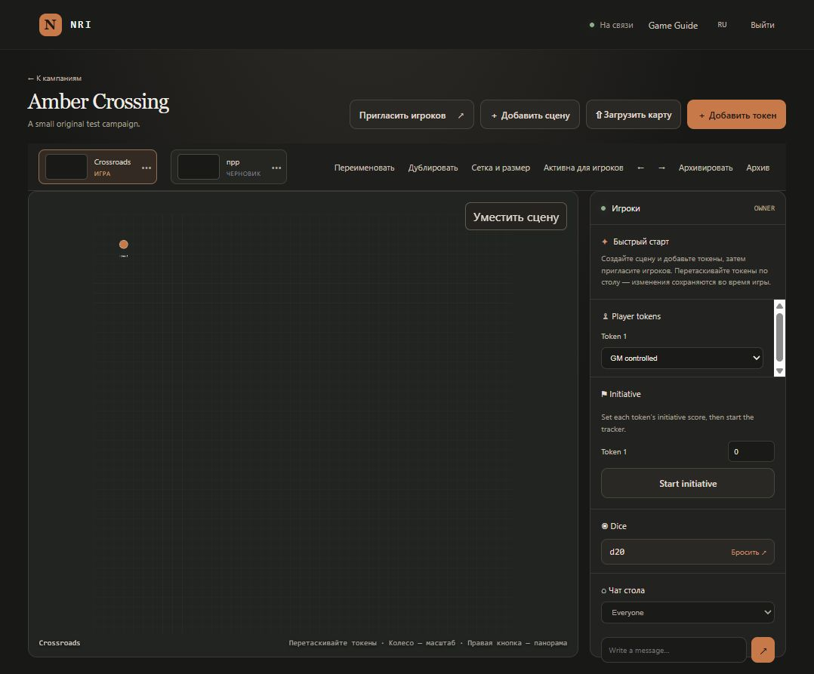

# V0.1.1 acceptance report

- **Report date:** 2026-11-24
- **Release:** Tabletop Foundation Completion & Playability
- **Status:** `IN_PROGRESS`
- **Branch:** `codex/v0-1-foundation-vtt`
- **Baseline:** `d919e7624e28a1b0e51009b9a2dfa8439776a1b7`
- **Pull request:** [#1](https://github.com/Jerry93Sky/NRI/pull/1), draft/open; not merged.

This report records work completed so far. It is not an acceptance declaration. The implementation adds scene preparation and active-scene privacy, but most of the requested V0.1.1 tabletop scope and several technical gates remain open.

## Implemented in this increment

- Added a migration for scene order, active/published state, dimensions, grid appearance/offset/snap/distance settings, and camera center/zoom. Existing scenes receive a deterministic order and one active/published scene per campaign. Migration applied to local `nri_dev` and isolated `nri_test` databases.
- Added scene rename and settings updates with optimistic versions; duplicate creates an unpublished draft and copies tokens with independent IDs while reusing the existing map asset reference.
- Added archive, restore, reorder, and GM activation flows. Archiving the active scene selects the most recently ordered remaining published scene as fallback when one exists.
- Player scene lists and token snapshots are limited to the active, non-archived scene. Players cannot request tokens from drafts or archived scenes. Scene activation is broadcast as `{sceneId}`; active-scene setting changes broadcast a public projection. Member removal emits a user-scoped `membership:removed` notice before the socket is removed from campaign rooms.
- Added UI controls for scene lifecycle, confirmation dialogs, archive recovery, thumbnails, and grid/map/camera configuration. The color picker keeps unsaved changes out of the current scene state.
- Bounded grid drawing to scene dimensions. Camera zoom math preserves the world coordinate under the pointer and is covered by tests.
- Lazy-loaded `TableCanvas`/PixiJS and localized scene preparation controls and camera hints. Compared with the baseline entry chunk at 598.21 kB minified / 180.66 kB gzip, the current build reports an entry chunk of 343.52 kB / 106.36 kB and a tabletop chunk of 269.82 kB / 78.96 kB. No chunk-size warning was reported in the latest web build.
- Added server and web Vitest suites and removed `--passWithNoTests` from those package scripts. Added scene lifecycle assertions to the existing multiplayer API/Socket.IO smoke suite.

## Verification performed

| Check | Result |
|---|---|
| Migration on local development DB and isolated `nri_test` PostgreSQL DB | Passed before final code review |
| `corepack pnpm@12.23.0 build` | Passed; main entry 343.52 kB / 106.36 kB gzip, tabletop chunk 269.82 kB / 78.96 kB gzip; no chunk warning |
| `corepack pnpm@12.23.0 typecheck` | Passed |
| `corepack pnpm@12.23.0 test` | 16 tests passed: 8 shared contracts, 6 server scene-access policy, and 2 web camera math |
| Server multiplayer smoke against local `nri_test` API | Passed, including active/draft privacy, settings and stale-version conflict, reorder, activation event, fallback, archive, restore, concurrent token conflict, and membership socket revocation |
| `git diff --check` | Passed; Git reports only expected Windows LF/CRLF normalization warnings |
| Browser review | Local app opened in the in-app browser. Reviewed scene tabs and settings form; canceled without saving changes to the existing Amber Crossing campaign. This was a UI review, not a two-account acceptance session. |
| GitHub Actions | Passed on commits `a414ae5` (run #8), `5cff5d3` (run #10), and `3f8aaaa` (runs #11 and #12) |

## Browser evidence

This is a real local browser capture of the existing demo while signed in as its owner. It demonstrates the Russian scene tab workbench and current tabletop shell; it is not evidence of player privacy or a full session acceptance.

The migration was applied to local `nri_dev` and isolated `nri_test`; later edits did not change schema. GitHub Actions run #12 passed on the latest published head `3f8aaaa`, including the code and documentation state before this report-only evidence refresh. This refresh changes no implementation and triggers CI for its new head.

## Still open against V0.1.1

- **Layers and scene objects:** no first-class layer/object schema or editor; GM layer model and object transforms are not implemented.
- **Grid calibration:** no map-segment measurement, cell-count calculation, or unsaved calibration preview.
- **Tokens:** no image-backed token library workflow, property card, resource tracks, notes, multi-select/group actions, rotation/resize/opacity, clipboard, delete recovery, or version-safe undo/redo.
- **Asset library:** upload is single-file and has basic PNG/JPEG/WebP signature filtering and a 12 MB multipart cap; there are no categories/search/thumbnails/usage/reference-aware deletion, complete decode validation, decoded-pixel caps, or storage usage view.
- **Tabletop tools/UI:** ruler, temporary pointer, drawing, layer toolbar, responsive panel controls, resizable/collapsible sidebars, fullscreen, theme preferences, and persisted personal layout are not implemented.
- **Reliability:** integration smoke covers scene privacy and reconnect but does not yet cover simultaneous conflicting moves, every hidden-object update/delete/reconnect projection, or socket revocation under multiple open client sockets.
- **Automated browser testing:** there is no Playwright suite or independent-context end-to-end coverage. Browser review above is manual and limited.
- **Security:** origin checks, session validation, membership checks, room checks, image byte signatures, and campaign asset ACLs exist in code; a full targeted security registry and dependency audit have not been completed. No independent security certification is claimed.
- **Operations/performance:** no coordinated DB/media backup manifest, isolated restore drill, three load scenes, six-player network test, FPS/latency/memory/server measurements, or texture-limit hardware survey.
- **Demo:** Amber Crossing remains a small local demo. It has not been expanded into the requested 30–60 minute multi-map scenario, and there is no new asset provenance/license inventory.

## Acceptance steps still required

1. Complete the open product and technical items above, add PostgreSQL-backed Playwright coverage, and make the required suites mandatory in CI.
2. Rerun migration, typecheck, build, all Vitest suites, the isolated multiplayer smoke, security checks, and operational drills; preserve exact outputs and environment details.
3. Run two independent browser contexts as GM and Player, exercise the full tabletop flows, capture real screenshots, and record remaining defects.
4. Update this report with final commit, CI run, measured outcomes, and documented manual acceptance steps. Keep status `IN_PROGRESS` until all technical gates pass; then use `MANUAL_ACCEPTANCE_PENDING` for owner review. Never mark `ACCEPTED` without the owner's decision.

## Manual review checklist

- Create, rename, duplicate, reorder, archive, restore, prepare, and activate scenes; confirm players see only the active scene.
- Upload and reuse a campaign image; confirm a player cannot read an unreferenced or draft-scene asset by direct URL.
- Move assigned and unassigned tokens from separate player accounts; test simultaneous edits and stale versions.
- Verify private chat, hidden tokens, hidden initiative, membership removal, reconnect, and server restart recovery.
- Exercise grid calibration, ruler, pointer, drawing, layers, resource library, undo/redo, and backup restore as those features are implemented.
