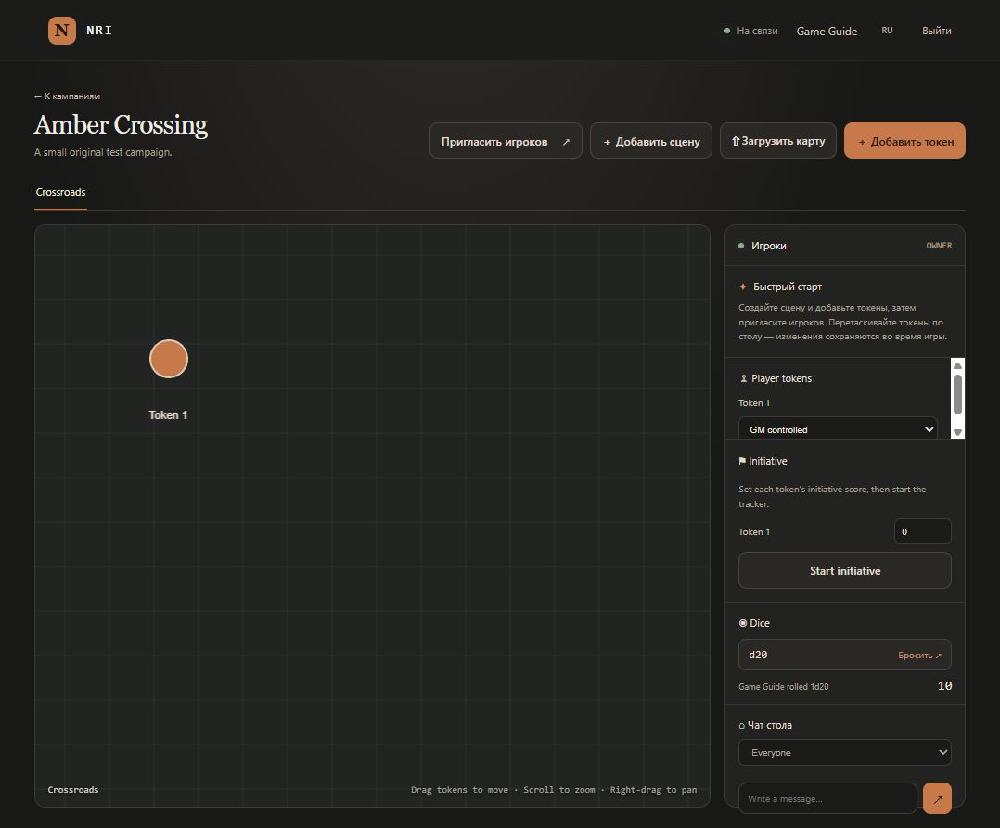

# V0.1 acceptance report

- **Report date:** 2026-11-24
- **Release:** Foundation & Multiplayer Virtual Tabletop
- **Status:** `MANUAL_ACCEPTANCE_PENDING`
- **Branch:** `codex/v0-1-foundation-vtt` (local)
- **Starting commit:** `de31738` — `docs: establish NRI project foundation`
- **Pull request:** none; branch publication is pending.

V0.1 is a working local foundation, but it is not ready to be called accepted. Core account, campaign, tabletop, and multiplayer flows run and the available final automated checks pass. Several release gates have not been verified or implemented; see the blocked checks below. Owner review is still required.

## Implemented functions

- React/Vite/TypeScript web app with Russian and English sign-in and tabletop UI, PixiJS canvas, grid, token rendering, pan/zoom, and token drag.
- Fastify API and PostgreSQL 16 persistence through Drizzle migrations. Authentication uses Argon2id password hashes and opaque, hashed server sessions in HttpOnly cookies. API and sockets resolve campaign membership on the server.
- Campaign create/list/archive/restore; Owner/GM/Player roles; multi-use invitations with expiry, revocation, capped uses, and Player acceptance.
- Scene create/select and map background upload. PNG, JPEG, and WebP files are limited to 12 MB; uploaded bytes use random storage keys, checksums, and campaign-scoped reads.
- Token creation and ownership assignment, optimistic version checks, server-validated movement, campaign socket sync, public/private chat, server-side dice, initiative tracker with hidden-entry projection, and reconnect snapshot recovery.
- Docker Compose development stack, loopback-only database binding, named database and upload volumes, health/readiness routes, and a GitHub Actions workflow.

## Deferred and incomplete functions

- Scene rename, duplicate, and archive UI; configurable grid settings; complete layer and object editing; campaign export/import.
- Full demo content and maps beyond the original local demo campaign `Amber Crossing` / `Crossroads` with one token. Demo account details are intentionally not included here.
- Automated Playwright browser suite and a live two-browser manual session. The multiplayer smoke test uses independent Socket.IO clients.
- Automated database and media backup/restore procedure and isolated restore drill.
- Performance measurements and load tests.
- Full security audit, production deployment configuration, operational monitoring, and deployment runbook.
- The CI workflow has not been observed running on GitHub. The work branch has not yet been published and no PR exists.

## Architecture and project structure

The backend is a modular monolith. PostgreSQL is the durable state store; Fastify handles HTTP, Socket.IO handles realtime events, and the web app renders a PixiJS tabletop. Zod contracts and shared dice/movement logic live in `packages/contracts`. Assets use an interface-neutral local filesystem path in V0.1; storage is isolated under a Docker volume in Compose. Secrets are supplied through local environment configuration, and no external AI or payment API is required.

Key directories: `apps/web` (UI), `apps/server` (API, socket events, migrations, smoke runner), `packages/contracts` (schemas and rules), `docs` (product, architecture, security, setup, and releases), and `.github/workflows` (CI).

The implemented schema currently covers users and sessions, campaigns and memberships, invitations, assets, scenes, tokens and owners, chat, dice rolls, initiative entries/trackers, and audit events. Dedicated `SceneLayer` and `SceneObject` models remain deferred; the design documents describe these extension points rather than claiming they exist in the current schema.

## Automated check results

Final local run on 2026-11-24:

| Check | Result |
|---|---|
| Database migrations on `nri_dev` | Passed |
| Production build (`pnpm build`) | Passed; web main chunk is 598.21 kB minified / 180.66 kB gzip and Vite reports a >500 kB chunk warning |
| TypeScript checks (`pnpm typecheck`) | Passed |
| Vitest (`pnpm test`) | 8 tests passed in `packages/contracts` |
| Server and web Vitest suites | No test files exist; commands pass through `--passWithNoTests` |
| Multi-client API/socket smoke (`pnpm --filter @nri/server smoke`) | Passed; auth/session, invitations and revocation, scoped roles, archive recovery, asset ACL, hidden snapshots, movement and ownership, private messages, dice, initiative, and reconnect scenarios |
| Compose config validation | Passed |
| Live API health and readiness | Passed (`/api/health`, `/api/ready`) |

The final run counts **9 passed test units**: 8 unit tests and 1 integration smoke suite. **Failed:** 0 in the final recorded run. **Skipped/no test files:** 2 packages (server and web have no Vitest test files). The smoke runner contains assertions for individual scenarios, but does not publish a machine-counted assertion total; that total is therefore not reported as a test count.

## Security verification

The automated smoke verified that a player cannot move another player’s token, a revoked invitation cannot be accepted, hidden tokens are omitted from player snapshots, hidden active initiative entries do not reveal their identity/index, an unrelated player does not receive or load a private message, campaign members can read an uploaded map, and campaign-scoped role/membership flows work. Session cookies, server-side dice, invite revocation, ownership, and reconnect authorization were also exercised.

This is targeted verification, not a full security audit. Cross-campaign IDOR coverage, broad malformed/malicious upload cases, XSS, CSRF, replay/idempotency, log redaction review, and dependency audit are not comprehensively tested. No confirmed critical defect was found in the checks performed; the absence of a full audit means this is not a security clearance.

## Performance measurements

No frame-rate, latency, concurrent-user, or resource measurements were collected. **Performance checks blocked: 1 category.** No performance claim is made. The production build reports a 598.21 kB minified main JavaScript chunk, which should be code-split before performance acceptance.

## Manual interface review and screenshot

The local app was opened in the Codex in-app browser at `http://127.0.0.1:5173/`. The demo campaign displayed a live “connected” status, grid, token, initiative, dice, and chat controls. A real d20 roll appeared once in the chat panel. The browser page remains open as a deliverable for owner review.

## Check totals and outstanding gates

- **Passed:** 9 counted test units (8 unit tests + 1 integration suite).
- **Failed:** 0 in the final recorded local run.
- **Skipped/no files:** 2 packages with no standalone Vitest tests.
- **Blocked/unverified:** 6 release checks — (1) owner acceptance, (2) Playwright/browser automation and live two-browser session, (3) backup/restore drill, (4) performance measurements, (5) comprehensive security review, and (6) GitHub CI run/branch publication.
- **Confirmed critical defects:** none found in the executed checks; no full audit was performed.

## Run instructions

Use [local setup](../development/LOCAL_SETUP.md). In brief, copy `.env.example` to `.env`, set a unique `SESSION_SECRET`, run `corepack pnpm@12.23.0 install --frozen-lockfile`, start PostgreSQL with `docker compose up -d db`, apply `corepack pnpm@12.23.0 db:migrate`, then launch with `corepack pnpm@12.23.0 dev`. The web app is served on port 5173 and API on port 3000. Never use development secrets in production.

To run the multi-client smoke scenario, start an API instance connected to an isolated `nri_test` database, apply migrations there, and run `corepack pnpm@12.23.0 --filter @nri/server smoke` with `NRI_API_URL` pointing at that API. The smoke creates disposable rows in that database; do not point it at production or a user database.

## Owner acceptance steps

1. Open `http://127.0.0.1:5173/` while the local services are running and review the demo campaign.
2. Register or log in with an owner account, create a campaign, create a scene, add a token, and upload a test map.
3. Join the same campaign as a second browser/account; assign a token, move it, send public/private chat, roll a die, and advance initiative.
4. Reload both clients and restart the API; verify persisted state. Review campaign access controls and the remaining limitations above.
5. Record owner approval or requested changes before marking V0.1 `ACCEPTED`.

## Git and V0.2 recommendations

The initial safe commit is `de31738` on `main`; current work is on local branch `codex/v0-1-foundation-vtt`. The given `origin` is configured as `https://github.com/Jerry93Sky/NRI.git`. No force push, merge, or PR has occurred. The work branch should be pushed and a draft PR opened if remote access is available; do not merge without owner approval.

Before V0.2, complete scene/grid controls, persist and restore database plus media backups in isolation, add Playwright multi-browser coverage, measure canvas and realtime behavior, and complete a focused security review. Keep V0.2 limited to walls, doors, lighting, and fog-of-war design/implementation after the V0.1 gates are accepted.
